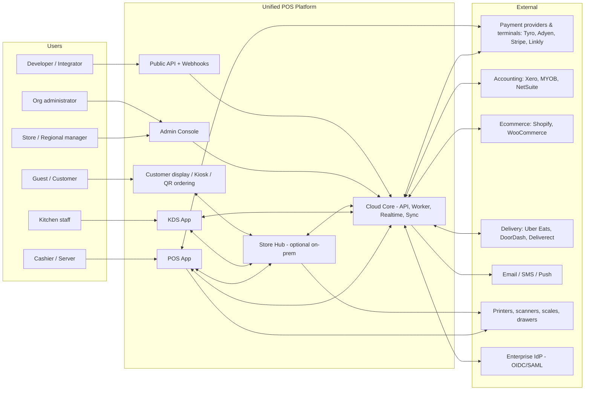
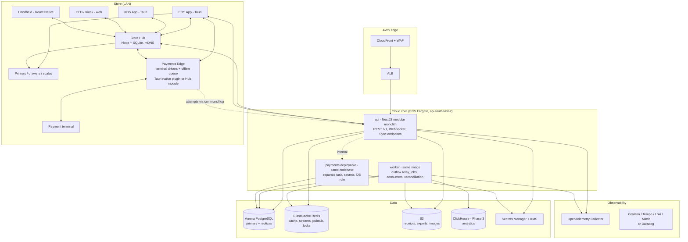
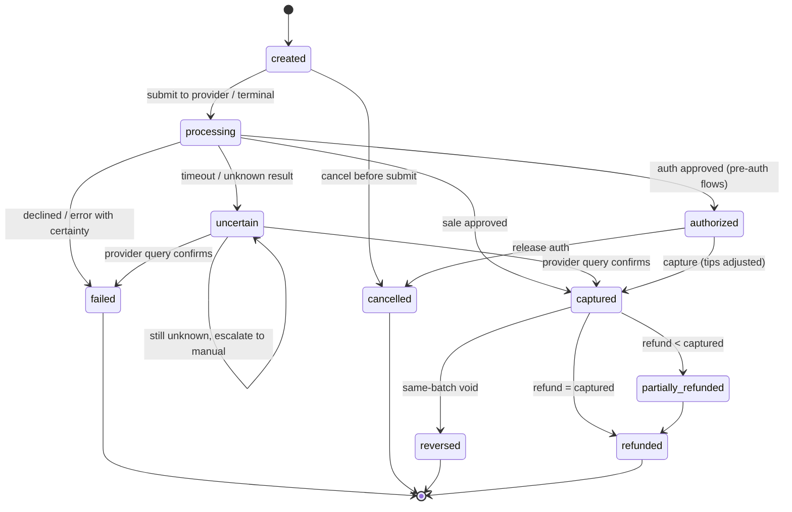
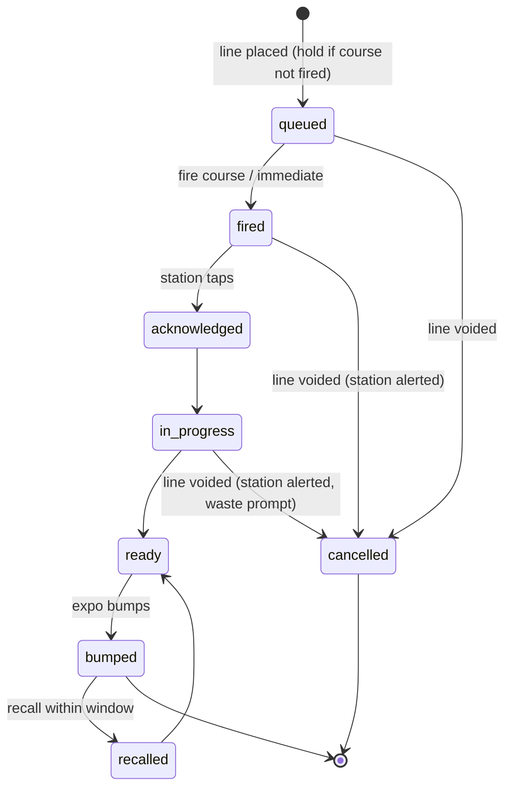

# Unified Retail & Restaurant POS Platform — System Architecture

Status: Proposal v1 (pre-implementation). Companion documents: [02-database-design.md](02-database-design.md), [db/schema.sql](../db/schema.sql), [03-implementation-plan.md](03-implementation-plan.md), [04-design-plan.md](04-design-plan.md).

---

## 1. Architecture summary

| Decision           | Choice                                                                                                                                                                   | Why                                                                                                                                                                     |
| ------------------ | ------------------------------------------------------------------------------------------------------------------------------------------------------------------------ | ----------------------------------------------------------------------------------------------------------------------------------------------------------------------- |
| Shape              | **Modular monolith** (NestJS/TypeScript) with 19 bounded-context modules, two deployables (`api`, `worker`) from one codebase                                            | Fast iteration, one transaction boundary where correctness needs it, no premature distributed-systems tax. Payments and reporting are the designated first extractions. |
| Data               | **PostgreSQL** (Aurora, multi-AZ) with shared schema, `tenant_id` on every row, **Row-Level Security** enforced at the connection level                                  | Tenant isolation at the database, not only in code. Enterprise customers can be moved to a dedicated cluster without code changes (tenant → cluster routing).           |
| Identifiers        | **UUIDv7** generated by the writer (client devices included)                                                                                                             | Offline creation, time-ordered indexes, idempotent replays.                                                                                                             |
| Money              | `bigint` minor units + ISO 4217 code; rates as `numeric`                                                                                                                 | No floating point in financial paths. Currency precision is config, not code.                                                                                           |
| Calculation engine | **Shared TypeScript `domain-core` package** (pricing, tax, promotions, order totals, state machines) executed on both server and POS client                              | Offline totals are byte-identical to online totals because they are the same code and same golden tests.                                                                |
| Async              | **Transactional outbox** → relay → Redis Streams (BullMQ) initially; NATS JetStream/Kafka when throughput or fan-out justifies                                           | Events are never lost between DB commit and publication. Consumers are idempotent by design.                                                                            |
| Offline            | **Command-log synchronization** (not row replication); three deployment profiles: Cloud-only, Device-autonomous, **Store Hub**                                           | Business facts (sales, orders, movements) are append-only commands that never conflict; configuration is server-authoritative.                                          |
| Payments           | **Payment orchestration layer**: PaymentIntent → PaymentAttempt state machines, provider adapters, semi-integrated certified terminals, no PAN ever touches the platform | Minimizes PCI DSS scope (target SAQ A / A-EP posture, to be validated with a QSA), vendor independence, provable no-double-charge.                                      |
| Clients            | POS & KDS: React + **Tauri 2** (Windows/macOS/Android/iOS webview shell with native plugins); Admin: Next.js; Handheld: React Native (Phase 3)                           | One React skill set; native layer only where hardware demands it.                                                                                                       |
| Infra              | AWS **ap-southeast-2 (Sydney)** first; ECS Fargate, Terraform, GitHub Actions, OpenTelemetry                                                                             | Australia is the first market; data residency by region from day one.                                                                                                   |

---

## 2. System context



---

## 3. Deployment profiles

The same software runs in three topologies. A location picks one; the platform knows which, and degradation behavior follows from it.

| Profile                  | Where state lives during an outage                                                                                                                          | Typical customer                                              | Offline capability                                                                                                                                                                               |
| ------------------------ | ----------------------------------------------------------------------------------------------------------------------------------------------------------- | ------------------------------------------------------------- | ------------------------------------------------------------------------------------------------------------------------------------------------------------------------------------------------ |
| **A. Cloud-only**        | Nowhere locally beyond a read cache                                                                                                                         | Single-register kiosk, pop-up                                 | Catalog browsing only; checkout requires connectivity. Explicitly chosen, never default.                                                                                                         |
| **B. Device-autonomous** | Each POS device keeps a local SQLite store (catalog, config, customers subset, its own order and command log)                                               | Independent retailer, cafe with 1–3 registers                 | Full checkout with cash, gift card (capped), and card where the terminal/provider supports store-and-forward. Orders are device-local until synced. KDS unavailable offline unless on Store Hub. |
| **C. Store Hub**         | A LAN service (Docker on a small box, or the "primary" register in hub mode) owns the live _store state_: open checks, table map, kitchen tickets, printers | Full-service restaurants, multi-register stores, QSR with KDS | Everything in B, plus shared open checks across devices, KDS routing, printing, table management with the internet down. Hub syncs with cloud using the same command protocol as a device.       |

Rules that fall out of this:

- Cloud is the **system of record** for everything once synchronized. Store Hub is the system of record for _live store state_ only while a location is operating under profile C, and only for that location.
- A device never talks to another device directly. It talks to the Hub if present, else to Cloud. This keeps the protocol one-to-one.
- Profile is a per-location configuration with a documented migration path (A → B → C) that requires no data migration, only enrollment.

---

## 4. Container view



### 4.1 Component responsibilities

| Component             | Responsibilities                                                                                                                                                                                                    | Not responsible for                                                        |
| --------------------- | ------------------------------------------------------------------------------------------------------------------------------------------------------------------------------------------------------------------- | -------------------------------------------------------------------------- |
| `api`                 | AuthN/AuthZ, tenant resolution, all synchronous commands and queries, WebSocket fan-out (via Redis pub/sub), sync upload/download endpoints, public API                                                             | Long-running work, provider webhooks processing beyond persisting to inbox |
| `worker`              | Outbox relay, event consumers (read models, loyalty, inventory consumption from recipes, notifications), scheduled jobs (reconciliation, replenishment suggestions, report generation, retention), webhook delivery | Serving user requests                                                      |
| `payments` deployable | Card-not-present and cloud-mode provider calls, webhook inbox processing, settlement import, reconciliation, tracking of offline-forward outcomes (approved / declined / expired)                                   | Anything that is not a payment; driving terminals on a store LAN           |
| Payments Edge         | Runs the terminal adapters that must live on the store network (Adyen local Terminal API, Stripe Terminal SDK, Tyro iClient); owns the offline store-and-forward queue, per-device caps and expiry; reports every attempt and outcome to the cloud through the command log. Hosted as a Tauri native plugin on the register (profile B) or as a Store Hub module (profile C) | Settlement, reconciliation, card-not-present flows                         |
| Store Hub             | LAN discovery (mDNS `_unifiedpos._tcp`), authoritative live store state for profile C, kitchen routing, print spooling, device session relay, cloud sync                                                            | Reporting, configuration authoring, user management                        |
| POS App               | Checkout and order entry UX, local catalog/config cache, local command log, hardware drivers (scanner, printer, drawer, scale, CFD); hosts the Payments Edge plugin in profile B                                     | Being a source of truth once synced                                        |
| KDS App               | Station queues, bump/recall, timers, all-day counts; connects to Hub (preferred) or Cloud                                                                                                                           | Order entry                                                                |
| Admin Console         | Configuration, catalog, people, devices, reports, audit, integrations                                                                                                                                               | Operating a register                                                       |

---

## 5. Modular monolith: domain modules

Each module is a NestJS module with a **public application-service interface** and **owned tables** (schema prefix in Postgres). Modules communicate in-process through those interfaces for synchronous needs and through domain events for everything else. Cross-module table access is forbidden and enforced by lint rules (`eslint-plugin-boundaries`) and an architecture test that parses Drizzle schema ownership.

| #   | Module          | Owns                                                                                                                                            | Key public operations                                                                         | Emits                                                                                                 |
| --- | --------------- | ----------------------------------------------------------------------------------------------------------------------------------------------- | --------------------------------------------------------------------------------------------- | ----------------------------------------------------------------------------------------------------- |
| 1   | `identity`      | users, credentials, sessions, roles, permissions, assignments, API clients                                                                      | authenticate, issue tokens, `can(principal, permission, scope)`, limits lookup                | `user.created`, `session.revoked`                                                                     |
| 2   | `tenancy`       | tenants, org units (closure), legal entities, locations, departments, registers, config entries, business days                                  | resolve hierarchy, effective config (`getConfig(scope, key)`), open/close business day        | `location.created`, `config.changed`, `business_day.closed`                                           |
| 3   | `catalog`       | items, variants, barcodes, categories, modifiers, menus, availability, recipes, suppliers (profiles)                                            | lookup by barcode/SKU/search, menu for (location, channel, time), validate modifier selection | `catalog.item.changed`, `menu.published`, `item.availability.changed`                                 |
| 4   | `pricing`       | tax classes/rules, price lists, promotions, coupons                                                                                             | `priceOrder(orderDraft, context)` → fully computed totals + applied rule trace                | `promotion.applied` (via orders)                                                                      |
| 5   | `inventory`     | inventory locations, balances, movements ledger, lots/serials, reservations, counts, transfers, purchase orders, receipts, cost layers          | record movement (transactional), reserve/release, count workflows, replenishment suggestions  | `inventory.movement.recorded`, `inventory.low_stock`, `po.received`                                   |
| 6   | `orders`        | orders, lines, modifiers, taxes, discounts, charges, checks, order events, receipts, number sequences                                           | create/modify order, place, suspend/resume, split/merge checks, void/return, finalize         | `order.placed`, `order.line.fired`, `order.completed`, `order.voided`, `order.returned`               |
| 7   | `fulfillment`   | fulfillments, external order links, channel integrations                                                                                        | route and track pickup/ship/delivery, import external orders                                  | `fulfillment.updated`                                                                                 |
| 8   | `tables`        | floor plans, areas, tables, table sessions, reservations, waitlist                                                                              | seat, merge, split, transfer, reserve                                                         | `table.status.changed`, `reservation.changed`                                                         |
| 9   | `kitchen`       | stations, routing rules, tickets, ticket items, kitchen events                                                                                  | route fired lines, bump/recall, fire courses, all-day counts                                  | `kitchen.ticket.updated`                                                                              |
| 10  | `payments`      | provider accounts, terminals, intents, attempts, events, refunds, card details, webhook inbox, settlements, reconciliation exceptions, disputes | create intent, process (cash/terminal/online), capture, refund, reconcile, query provider     | `payment.authorized`, `payment.captured`, `payment.failed`, `refund.succeeded`, `settlement.imported` |
| 11  | `cash`          | drawers, cash sessions, cash movements, counts                                                                                                  | open/close session, paid in/out, drop, count, variance approval                               | `cash.session.closed`, `cash.variance.flagged`                                                        |
| 12  | `customers`     | customers, identities, groups, consents, notes, loyalty programs/accounts/ledger, gift cards, store credit                                      | find/attach customer, earn/redeem (idempotent), gift card issue/redeem, consent record        | `loyalty.earned`, `gift_card.redeemed`                                                                |
| 13  | `workforce`     | employees, assignments, shifts, tasks/checklists, approvals                                                                                     | clock-in link, shift state, approval requests                                                 | `shift.closed`, `approval.decided`                                                                    |
| 14  | `reporting`     | read models (`rm_*`), report definitions, exports, saved views                                                                                  | query dashboards, schedule/async export, freshness                                            | `report.export.ready`                                                                                 |
| 15  | `notifications` | templates, outbound messages, provider refs                                                                                                     | send transactional email/SMS/push via providers with consent check                            | `notification.sent`                                                                                   |
| 16  | `integrations`  | webhook subscriptions/deliveries, OAuth apps, integration health, connector configs (accounting, ecommerce, delivery)                           | deliver webhooks, run connectors                                                              | `webhook.delivery.failed`                                                                             |
| 17  | `devices`       | devices, enrollment codes, peripherals, heartbeats, sync cursors/batches/conflicts, change feed                                                 | enroll/revoke, heartbeat, `sync.upload(batch)`, `sync.download(cursor)`                       | `device.enrolled`, `device.offline`                                                                   |
| 18  | `audit`         | audit log (hash-chained), idempotency keys, processed events                                                                                    | `record(action)`, verify chain, idempotency middleware                                        | —                                                                                                     |
| 19  | `platform`      | feature flags, plans, platform operators, tenant provisioning, health                                                                           | provision tenant, toggle flags, system health                                                 | `tenant.provisioned`                                                                                  |

### 5.1 Request pipeline

```
HTTP/WS request
 → Rate limit (Redis token bucket; keyed by tenant+principal; internal POS fails open with alert, public API fails closed)
 → AuthN guard (JWT access token or device-bound POS session; mTLS/signature for Store Hub)
 → Tenant resolution (ONLY from the verified token, never from path/body)
 → Scope resolution (location/register in path must be within principal's assignments; otherwise 404)
 → AuthZ policy (permission key + ABAC limits, e.g. orders.discount.apply with max_percent)
 → Idempotency filter (Idempotency-Key header; stored request hash + response replayed on duplicate)
 → Application service
      BEGIN; SET LOCAL app.tenant_id = $1;        ← RLS context
      domain logic (pure, from domain-core)
      repositories (owned tables only)
      outbox.append(events)                        ← same transaction
      audit.record(action)                        ← same transaction
      COMMIT
 → Response (ETag = row version for optimistic concurrency on subsequent writes)
```

Every write that mutates financial or inventory state runs inside **one database transaction**. Eventual consistency is reserved for read models, notifications, loyalty accrual, external connectors, and analytics, and each of those shows its freshness.

---

## 6. Multi-tenancy and authorization

### 6.1 Hierarchy

```
Tenant (organization)
 └─ Org unit (company | brand | region | business_entity | franchise_group)   ← arbitrary depth, closure table
     └─ Location (store | restaurant | warehouse | central_kitchen)
         └─ Department
             └─ Register
```

Legal entities are attached to org units or locations and carry tax registrations (e.g. ABN/GST registration), receipt legal text, and fiscal settings. Franchise boundaries are org units with `kind = franchise_group` and a reporting-visibility flag that stops upward data flow except agreed aggregates.

### 6.2 Isolation layers (defense in depth)

1. **Database:** RLS policy `tenant_id = current_setting('app.tenant_id')::uuid` on every tenant table; application role is not table owner; `FORCE ROW LEVEL SECURITY`. Composite foreign keys include `tenant_id` so a row cannot reference another tenant's parent.
2. **Repository:** every query is built from a `TenantScopedDb` handle that cannot be constructed without a resolved tenant; location-scoped repositories additionally require a location set.
3. **Service:** `AuthorizationService.can()` is called in the application service, not the controller, so internal callers (jobs, sync) are also checked.
4. **API:** object IDs outside the principal's scope return 404. Cross-tenant tests are part of CI for every endpoint (see testing strategy).

### 6.3 Permission model

- Permission keys are `resource.action` (`orders.void`, `inventory.adjust`, `reports.financial.view`, `catalog.price.edit`).
- Roles bundle permissions. System roles ship with the product (the 21 roles in the brief); tenants can clone and customize.
- `role_assignments` bind a user to a role at a **scope** (tenant, org unit, location, register). Effective permissions at a location = union over assignments whose scope is the location or an ancestor.
- **Limits** (ABAC attributes) ride alongside: `orders.discount.max_percent = 15`, `orders.refund.max_minor = 20000`, `orders.price_override.allowed_categories = [...]`. Exceeding a limit triggers an **approval request** (manager PIN/passkey at the register, or remote approval from the Admin Console) instead of a hard failure.
- Temporary elevation is a time-boxed `role_assignment` with `valid_to`, recorded in audit.
- MFA (TOTP/passkey) is mandatory for roles holding any `*.admin` or `finance.*` permission. POS staff authenticate with a device-bound session plus a per-location PIN; PIN entropy/lockout policies are tenant configuration.

---

## 7. Core domain models

### 7.1 Order, check, line

Retail sales and restaurant orders are **one aggregate**: `Order` with `kind` (retail_sale, return, dine_in, takeaway, delivery, …). A retail sale is simply an order with one check that completes immediately. This gives one pricing engine, one payment flow, one reporting model.

Three **orthogonal status fields** avoid the state explosion of a single enum:

| Field                | Values                                                                                                     | Meaning                                                |
| -------------------- | ---------------------------------------------------------------------------------------------------------- | ------------------------------------------------------ |
| `status`             | draft → open → completed; open → suspended → open; open/draft → cancelled; completed → voided (authorized) | Commercial lifecycle                                   |
| `fulfillment_status` | unfulfilled, in_preparation, partially_ready, ready, fulfilled                                             | Kitchen/pick/ship progress, derived from lines/tickets |
| `payment_status`     | unpaid, partially_paid, paid, partially_refunded, refunded                                                 | Derived from captured payment intents and refunds      |

`Check` is the billable unit. Every order has one default check; restaurants may split into N. Split by item = move lines between checks; split by seat = move lines by `seat_number`; split by amount = multiple payment intents against the same check; **shared item** = split a line into fractional quantities (`quantity numeric(14,4)`) across checks so totals still reconcile line by line.

Returns and exchanges are **new orders** of kind `return`/`exchange` whose lines reference the original line (`return_of_line_id`), so original records are never mutated and refund reconciliation is a join.

### 7.2 Pricing and tax pipeline (domain-core, deterministic)

```
inputs: order draft, location, channel, business time, customer, price lists in scope, promotions in scope, tax rules
1. Resolve base unit price per line: price override → customer/channel price list by priority → location/org list → variant default
2. Apply line-level manual discounts (with authorization trace)
3. Evaluate promotions: filter by scope/schedule/eligibility → sort by (priority asc, created_at asc) → apply respecting stacking groups and exclusions → record PromotionApplication per rule with the exact lines and amounts
4. Allocate order-level discounts proportionally to lines (largest-remainder method so sums match exactly)
5. Compute tax per line from the tax rule set for (jurisdiction, tax class, customer exemption, inclusive/exclusive mode); persist OrderLineTax rows
6. Charges (service charge, surcharge, delivery fee) with their own tax treatment
7. Rounding (cash rounding rules per currency, e.g. AUD 5c) applied only to the cash tender, recorded as rounding_minor
8. Output: totals + an ordered trace used for receipts, audit, and tests
```

Golden-file tests (JSON in → totals out) are the contract. The same `priceOrder()` runs in the POS app offline and on the server; the server recomputes on sync and flags any mismatch as a `sync_conflict` of kind `pricing_mismatch` (which only happens when configuration changed between offline sale and sync; policy: honor the price the customer paid, record the delta).

### 7.3 Payment state machine



Invariants enforced in code and by DB constraints:

- An order is `paid` only when `sum(captured_minor − refunded_minor)` over intents ≥ check total. Never on "request sent".
- `uncertain` is a first-class state. The POS shows "Confirming with terminal…", and the platform **queries the provider** (`getStatus(providerReference)`) before any retry. A retry is a new intent with a new idempotency key only after the previous one is terminal `failed`/`cancelled`.
- Idempotency key = `(tenant, device, client_intent_id)`; the provider's own idempotency facility is used where offered (Stripe `Idempotency-Key`, Adyen `reference`).
- `payment_events` is append-only and is the audit of record; `payment_intents.status` is a projection.
- Settlement is tracked separately (`settlement_status`: unsettled, settled, disputed) via imported provider settlement files, never inferred from capture.

### 7.4 Provider adapter interface

```ts
interface PaymentProviderAdapter {
  readonly key: 'stripe' | 'adyen' | 'tyro' | 'windcave' | 'linkly' | 'mock';
  capabilities(account: ProviderAccount): Capabilities; // { cardPresent, cardNotPresent, preAuth, tipAdjust, offlineStoreAndForward, refundsWithoutOriginal, surcharging, currencies[] }
  createPayment(req: PaymentRequest, idem: IdempotencyKey): Promise<ProviderResult>; // sale or auth
  capture(ref: ProviderRef, amount: Money, idem: IdempotencyKey): Promise<ProviderResult>;
  refund(ref: ProviderRef, amount: Money, idem: IdempotencyKey): Promise<ProviderResult>;
  reverse(ref: ProviderRef, idem: IdempotencyKey): Promise<ProviderResult>;
  getStatus(ref: ProviderRef): Promise<ProviderStatus>; // used for `uncertain`
  verifyWebhook(headers, rawBody, secret): WebhookEvent | InvalidSignature;
  importSettlement(period): AsyncIterable<SettlementLine>;
}

interface TerminalAdapter {
  pair(terminal: TerminalInfo, code: string): Promise<PairingResult>;
  startTransaction(session: TerminalSession, req: TerminalRequest): AsyncIterable<TerminalEvent>; // progress events to UI
  cancel(session: TerminalSession): Promise<void>;
  lastTransactionResult(terminal: TerminalInfo): Promise<ProviderStatus>; // crash recovery
  health(terminal: TerminalInfo): Promise<TerminalHealth>;
}
```

Terminal integration modes, in order of preference for stores that need offline card acceptance (provider documentation, October 2026):

| Mode | Examples | Where the adapter runs | Offline card (store-and-forward) | Notes |
|---|---|---|---|---|
| **LAN / local terminal API** | Adyen Terminal API local, Tyro iClient (browser JS over LAN) | Payments Edge | Adyen: yes, within merchant-configured amount and count caps; Tyro: not documented, to be confirmed in certification | Requires terminal TLS certificate handling and a stable LAN; Tyro certification is mandatory before production |
| **Native SDK** | Stripe Terminal mobile/smart-reader SDKs | Payments Edge (Tauri native plugin) | Yes: Stripe-enforced USD 10,000 cap, reader must have connected online within 24 h on the same LAN and been updated within 30 days | The Stripe **JavaScript SDK does not support offline**; a webview-only integration cannot offer offline card |
| **Cloud terminal API** | Adyen Terminal API cloud, Stripe server-driven | `payments` deployable | **No** (Adyen: only if the link drops after the terminal already received the request; Stripe: unsupported) | Simplest integration; acceptable for profile A stores and as a fallback when the Edge is unavailable |

Rules that follow: the adapter's `capabilities.offlineModes` is per connection mode, not per provider; the UI may only show "terminal may approve offline" when the configured mode supports it and the tenant has enabled caps; American Express refuses offline authorisation in Australia and Stripe refuses EFTPOS-only cards (per Stripe's offline FAQ; its smart-reader page lists eftpos co-branded cards as supported offline, so confirm in the sandbox) and swiped cards offline, so the **terminal decides** and the POS never promises offline card acceptance. The platform never receives PAN or CVV; receipts use provider-returned masked data plus the terminal's printable receipt block.

### 7.5 Inventory ledger

- `inventory_movements` is **append-only** (trigger forbids UPDATE/DELETE). Every stock change is a movement with a `reason`, a `reference` (order line, PO receipt, transfer, count, waste record), the actor, the device, `occurred_at` (business time) and `recorded_at` (server time).
- `inventory_balances` is a **derived projection** updated in the same transaction as the movement (`UPDATE … SET on_hand = on_hand + delta`). A nightly job recomputes balances from movements and raises `reconciliation_exceptions` on drift; it never silently overwrites.
- Stock counts produce **adjustment movements** for variances; the count itself is a workflow object with blind mode.
- Availability for sale = `on_hand − reserved − quarantined`. Reservations are explicit rows with expiry, used by click-and-collect and online orders.
- Costing: weighted average by default (cost on the balance), FIFO cost layers available per tenant policy (Phase 3). Accounting treatment is exported to the ERP/accounting integration, not computed as GL here.
- Recipe consumption: on `order.completed` (or `order.line.fired` for QSR, configurable) the worker explodes recipes + modifier effects and records `recipe_consumption` movements at the ingredient level. Voids/comps/staff meals use distinct reasons so theoretical vs actual food cost remains separable.

### 7.6 Kitchen ticket lifecycle



Routing: `kitchen_routing_rules` match on category/item/tag/channel with priority → station. One order line may fan out to several stations (e.g. burger to grill, fries to fry) as separate ticket items; the expo station sees the consolidated order. Updates are **at-least-once with acknowledgement**: Hub/Cloud keeps a per-station delivery cursor; a KDS that reconnects replays from its cursor. Printer fallback: if a station's KDS misses heartbeats for N seconds, tickets for that station are spooled to its configured printer and marked `printed_fallback`.

---

## 8. Offline-first and synchronization

### 8.1 Local data model (POS, KDS, Hub)

SQLite (WAL mode, SQLCipher encryption at rest, key in OS keychain / Android Keystore) with three groups of tables:

1. **Replicas (read-only on device):** catalog, menus, modifiers, price lists, promotions, tax rules, config, employees/PINs (hashed), customer subset (recent + loyalty members of this location), open orders of this location (profile C via Hub).
2. **Command log (append-only):** `commands(client_command_id ULID, type, payload, hlc, created_at, status pending|acked|rejected, server_result)`.
3. **Local projections:** the device's own orders/checks/intents, built by applying its own commands locally with the same domain-core reducers that the server uses.

### 8.2 Protocol

```
UPLOAD  POST /v1/sync/batches
        { device_id, client_batch_id, commands: [ {client_command_id, type, payload, hlc, client_time} ... ] }
        → per command: applied | duplicate | rejected{code, detail}   (batch is processed in order, each command in its own transaction)
DOWNLOAD GET /v1/sync/feed?streams=catalog,config,customers,orders,kitchen&cursor=<seq>
        → ordered change records from change_feed (seq, entity, op, version, payload) + new cursor; snapshot endpoint for bootstrap
REALTIME WebSocket: server pushes "feed has new data for stream X" hints; clients still pull by cursor (pull is the truth, push is a hint)
```

Design points:

- **Commands, not rows.** The server re-validates and re-executes each command through the normal application service (same authorization, same pricing). This keeps business rules in one place and makes the sync surface small.
- **Idempotency** on `client_command_id`; replays after a crash are harmless.
- **Ordering** per device is preserved; across devices, order of facts is by hybrid logical clock (`hlc`), and the server stamps `recorded_at`.
- **Conflicts** are rare by construction: sales/orders/movements are append-only facts; config is server-wins; the only true conflicts are concurrent edits to a shared open check in profile C with the Hub down (two devices editing the same table offline). Policy: Hub is authoritative for open checks; if a device cannot reach the Hub it may _view_ but not edit a check it does not own, except to add new lines (append), which merge trivially. Edits that cannot be merged become `sync_conflicts` for a manager with both versions shown.
- **Rejected commands** (e.g. a void now exceeds the cashier's limit because roles changed) are surfaced to a manager queue; the sale itself still stands.
- **Order numbers** offline are `<register_code>-<local_seq>`; the server assigns the canonical per-location sequence on sync; both are printed/stored.
- **Business date** is computed from the location's time zone and configured day boundary using the client `occurred_at`, so late-synced sales land in the right day.

### 8.3 Offline payments policy

| Tender                                         | Offline                                                                         | Controls                                                                                                                                                   |
| ---------------------------------------------- | ------------------------------------------------------------------------------- | ---------------------------------------------------------------------------------------------------------------------------------------------------------- |
| Cash                                           | Yes                                                                             | None beyond drawer accountability                                                                                                                          |
| Gift card / store credit                       | Yes                                                                             | Local balance snapshot; per-transaction cap; flagged for server validation; negative-balance reconciliation report                                         |
| Loyalty redemption                             | Yes, capped                                                                     | Points reserved locally; server validates; duplicates prevented by idempotent ledger key                                                                   |
| Card present                                   | **Only if** the configured connection mode supports it (see §7.4 table) and the tenant has set caps | Per-transaction cap, per-device count and sum caps, expiry window, automatic forward on reconnect, and the decline-after-forward workflow below |
| Card not present, wallets, BNPL, bank transfer | No                                                                              | UI offers "hold order / pay later"                                                                                                                         |

Every locally recorded sale carries `settlement_pending = true` until the server confirms capture; reports distinguish _recorded_ from _settled_.

Provider rules the Payments Edge must encode (vendor documentation, October 2026):

| Provider | Offline modes | Caps and windows | Excluded offline | After forwarding |
|---|---|---|---|---|
| Adyen | Local Terminal API, standalone, mobile SDK; **not** cloud | Merchant-set per-transaction maximum and per-terminal count, configured by Adyen Support; mobile 24 h after attestation; none during an Adyen outage | Most local schemes, QR wallets, magstripe, cashback; **Amex in Australia**; mobile is offline-PIN only | Issuer may decline; Auto Rescue retries for one month; only unreferenced refunds offline |
| Stripe Terminal | Mobile/smart-reader SDKs, Apps on Devices; **not** JS SDK or server-driven | USD 10,000 per transaction (Stripe), lower merchant limits by amount/count; reader online within 24 h on same LAN, updated within 30 days | Swipe, contactless in SCA markets, EFTPOS-only cards (per Stripe's offline FAQ; its smart-reader page lists eftpos co-branded cards as supported offline, so confirm in the sandbox); no cancel/refund until forwarded | PaymentIntent id is null until forwarded; reconcile via metadata and webhooks; merchant bears decline and tamper risk |
| Square (reference) | Square hardware only | Merchant-set cap; 72 h upload deadline, 24 h sessions on readers; expired payments unrecoverable | Physical contactless, gift cards, manual entry | No decline notifications; review in reports |
| Toast (reference) | Toast devices | Optional cap with manager approval above it | Gift cards, loyalty, house accounts; cannot close checks or declare tips offline | Declined card → check tagged and reopened |
| Clover (reference) | Clover devices | Up to 7 days (fixed), default USD 500 per transaction | Pre-auth and capture | Device-level settings |

Offline card lifecycle in the platform: `payment_intents.offline = true` with `forward_outcome = 'pending'` and `offline_expires_at` set from the provider window → the Edge forwards on reconnect and records `forwarded_at` → outcome `approved` (normal capture path), `declined` or `expired`. A decline or expiry reopens the check (`orders.reopened_reason`, event `reopened_offline_decline`), raises a `reconciliation_exceptions` row of kind `offline_declined` / `offline_expired`, and places the order in the manager's "Offline payments awaiting outcome" queue for re-collection, customer contact or write-off. Caps on count and sum are enforced at the Edge from `devices.health` counters and proven nightly against `offline_device_seq`.

### 8.4 Failure and recovery

| Scenario                  | Behavior                                                                                                                                                                      |
| ------------------------- | ----------------------------------------------------------------------------------------------------------------------------------------------------------------------------- |
| App crash mid-checkout    | Command log is written before UI acknowledgement; on restart the open order is reconstructed and any in-flight terminal transaction is resolved via `lastTransactionResult()` |
| Device storage near quota | Warn at 80 %, block new non-essential caches at 90 %, purge synced history older than retention; never block cash sale while unsynced commands exist (they are tiny)          |
| Prolonged outage (days)   | Catalog/config may be stale: show "last updated" banner; price changes queued server-side apply on reconnect; manager sees a reconciliation summary                           |
| Device lost/stolen        | Enrollment revoked → server rejects its sessions; local DB is encrypted; remote wipe command on next contact                                                                  |
| Hub failure in profile C  | Devices fall back to Cloud if online, else to device-autonomous mode with read-only view of others' checks; Hub rebuild = re-enroll and resync from Cloud                     |

---

## 9. Events, integrations, extensibility

- **Outbox:** `outbox_events` written in the business transaction; `worker` relay publishes to Redis Streams (consumer groups per consumer), marks `published_at`. Consumers record `processed_events(consumer, event_id)` for idempotency. Dead-letter stream after N attempts with alerting.
- **Event catalog** (excerpt): `order.placed`, `order.completed`, `order.voided`, `order.returned`, `payment.captured`, `payment.failed`, `refund.succeeded`, `inventory.movement.recorded`, `inventory.low_stock`, `kitchen.ticket.updated`, `cash.session.closed`, `loyalty.earned`, `customer.updated`, `catalog.item.changed`, `menu.published`, `device.offline`. All carry `tenant_id`, `location_id`, aggregate id/version, `occurred_at`, `causation_id`, `correlation_id`.
- **Public API:** REST `/v1`, OpenAPI 3.1 generated from code (Nest + zod), OAuth 2.0 client credentials with scopes (`orders:read`, `inventory:write` …), `Idempotency-Key` on all POSTs, cursor pagination, `If-Match` ETags, per-client rate limits, sandbox tenants.
- **Webhooks out:** HMAC-SHA256 over `timestamp.body`, 5-minute tolerance, retries with exponential backoff for 24 h, delivery log visible to the tenant, replay from Admin Console.
- **Plugin model (Phase 3/4):** no arbitrary code in the POS core. Extensions are (a) webhooks + API, (b) declarative UI extension points (custom buttons, receipt blocks, order metadata forms described in JSON schema), (c) sandboxed server functions (isolated runtime such as V8 isolates, resource-limited, scoped tokens). Marketplace apps register, request scopes, and are approved per tenant.

---

## 10. Reporting and analytics

| Tier                         | Technology                                                                                                                                                                                                      | Freshness | Use                                                 |
| ---------------------------- | --------------------------------------------------------------------------------------------------------------------------------------------------------------------------------------------------------------- | --------- | --------------------------------------------------- |
| Operational dashboards       | Postgres read models (`rm_sales_daily`, `rm_item_sales_daily`, `rm_payment_method_daily`, `rm_cash_variance_daily`, `rm_kitchen_times_daily`) maintained by event consumers; live counters in Redis for "today" | Seconds   | Store dashboard, X/Z reports, KDS KPIs              |
| Historical/financial reports | Same read models + direct transactional queries on a read replica; async export jobs to S3 (CSV/XLSX/PDF)                                                                                                       | Minutes   | Finance, auditors                                   |
| Analytics / BI (Phase 3)     | ClickHouse fed from outbox events (CDC fallback via Debezium); dbt models; BI tool connectors                                                                                                                   | Minutes   | Basket analysis, forecasting features, benchmarking |

Conventions: every report states its time zone (location or tenant reporting TZ), currency (location currency, with converted column at stated rate when consolidating), and accounting convention (gross vs net, inclusive vs exclusive tax). A nightly **reconciliation job** proves `rm_*` totals equal sums over `orders`/`payment_intents` per business date; drift raises an alert, never a silent fix. Settlement reports, operational sales, inventory valuation and GL exports are four separate report families with documented bridges.

---

## 11. Security architecture

| Area           | Control                                                                                                                                                                                                                                                                 |
| -------------- | ----------------------------------------------------------------------------------------------------------------------------------------------------------------------------------------------------------------------------------------------------------------------- |
| Authentication | OIDC (own IdP via Keycloak/Auth0/Cognito, plus enterprise SSO federation), passkeys/TOTP MFA for privileged roles, device-bound POS sessions (device key pair + short-lived tokens), per-location staff PINs with lockout                                               |
| Authorization  | RBAC + ABAC limits, scope hierarchy, service-layer checks, RLS, 404-on-out-of-scope, approval workflows, dual approval option for high-risk actions (bulk price change, refund over threshold, user role grant with admin)                                              |
| Transport      | TLS 1.2+ everywhere; mTLS or signed requests for Store Hub ↔ Cloud; certificate pinning in POS apps (with rotation plan)                                                                                                                                                |
| At rest        | Aurora KMS encryption, S3 SSE-KMS, SQLCipher on devices, field-level encryption (application-side, envelope keys) for customer DOB/phone/email and any PII under stricter residency                                                                                     |
| Secrets        | AWS Secrets Manager; DB stores only `credentials_ref`; payments deployable has its own IAM role and DB role with access limited to payment tables                                                                                                                       |
| Payments       | No PAN/CVV/track data ever; certified terminals; tokenized references only; webhook signature + replay window + inbox dedupe; PCI responsibility matrix documented per provider; scope validated with a QSA before launch (claims of SAQ level are not made until then) |
| App security   | Input validation with zod on every boundary, output encoding, CSRF-free token auth, CSP, dependency scanning (Renovate + OSV), SAST, container scanning, secrets scanning in CI                                                                                         |
| Audit          | `audit_log` append-only with per-tenant hash chain (`hash = sha256(prev_hash ‖ canonical(row))`), periodic anchor of chain head to S3 Object Lock; all config changes, price changes, voids, refunds, permission grants, reprints logged with actor, device, reason     |
| Monitoring     | Auth anomaly alerts (impossible travel, brute force), refund/void pattern detection, cash variance alerts, cross-tenant access attempts (always a P1)                                                                                                                   |
| Privacy        | Consent registry, purpose limitation flags on PII access, data retention policies per tenant/region, export and erasure workflows (GDPR/Australian Privacy Principles), region-pinned deployments for residency                                                         |
| IR / DR        | Incident runbooks, on-call, tabletop exercises; DR targets in §12                                                                                                                                                                                                       |

Threat model (STRIDE top items) is maintained in `docs/security/threat-model.md` (to be produced in Phase 1, slice 1): cross-tenant data access via IDOR, payment replay/duplicate capture, offline device tampering (forged commands), webhook forgery, privilege escalation via role assignment, receipt/refund fraud, Store Hub impersonation on LAN.

---

## 12. Reliability, SLOs, degradation, DR

### 12.1 Service-level objectives (to be validated by load tests before GA)

| Capability                                   | Objective                                                                            |
| -------------------------------------------- | ------------------------------------------------------------------------------------ |
| Online product lookup (barcode/SKU)          | p95 < 200 ms                                                                         |
| Standard API request                         | p95 < 300 ms                                                                         |
| Local cached lookup on device                | p95 < 100 ms                                                                         |
| Checkout commit (excluding external payment) | p95 < 500 ms online; < 150 ms local                                                  |
| Admin dashboard first useful paint           | < 2 s                                                                                |
| Core API availability (monthly)              | 99.95 %                                                                              |
| Sync feed lag                                | p95 < 5 s online                                                                     |
| Kitchen ticket delivery (Hub)                | p95 < 1 s                                                                            |
| Acknowledged financial transaction loss      | 0 (hard invariant, tested)                                                           |
| Duplicate charge from internal retry         | 0 (hard invariant, tested)                                                           |
| RPO / RTO (cloud, region loss)               | Phase 1: 5 min / 4 h (restore); Phase 3: 5 min / 1 h (warm standby in second region) |

### 12.2 Graceful degradation matrix

| Failure                            | Checkout                                                                          | Kitchen                           | Reporting           | Admin                     |
| ---------------------------------- | --------------------------------------------------------------------------------- | --------------------------------- | ------------------- | ------------------------- |
| Reporting read models lagging/down | Unaffected                                                                        | Unaffected                        | Stale with banner   | Unaffected                |
| Redis down                         | Slower (no cache), rate limiting fails open for POS, WS hints lost → clients poll | Hub-local unaffected              | Live counters stale | Unaffected                |
| Postgres failover (~30 s)          | Devices queue commands, retry with jitter                                         | Hub-local unaffected              | Unavailable briefly | Unavailable briefly       |
| Payment provider down              | Other tenders; store-and-forward if enabled                                       | Unaffected                        | —                   | Provider health shown red |
| Internet down at store             | Profile B/C offline modes                                                         | Profile C unaffected; B loses KDS | None                | None                      |
| Printer down                       | Digital receipt, reprint later, alert                                             | Fallback to other station/KDS     | —                   | —                         |
| Router restarted during an outage  | Devices keep static-address fallback to Hub and printers; if the Hub is unreachable, device-autonomous mode | Printing continues via direct printer addresses; KDS replays from cursor on reconnect | — | — |
| Store Hub lost (profile C)         | Devices fall back to Cloud if online, else device-autonomous; new checks only, others read-only | KDS falls back to Cloud routing or printer fallback | — | Hub health alert |

### 12.3 Operations

Multi-AZ everything; blue/green deploys with automatic rollback on SLO burn; database migrations expand/contract only (no destructive change in the same release as code that depends on it); load/stress/soak tests in CI nightly against a production-like environment with synthetic tenants; chaos experiments (kill worker, partition Hub, inject provider timeouts) from Phase 2; capacity plan reviewed quarterly.

---

## 13. Observability

- **Tracing:** OpenTelemetry in `api`, `worker`, Store Hub, and POS (sampled); `correlation_id` from the client command flows through events, webhooks, and provider calls.
- **Metrics:** RED per endpoint, queue depth/lag per stream, outbox backlog, sync lag per device, terminal transaction durations, payment `uncertain` count (paged), RLS context-missing counter (must be zero; any non-zero pages), device offline counts.
- **Logs:** structured JSON, PII-redacted at source, retention per region.
- **Alerts:** SLO burn-rate alerts, payment reconciliation exceptions, audit chain verification failure, cross-tenant access attempt, webhook delivery failure rate, store offline > N minutes.

---

## 14. Architecture decision records (index)

| ADR | Decision                                                                        | Alternatives considered                           | Status                                                                                            |
| --- | ------------------------------------------------------------------------------- | ------------------------------------------------- | ------------------------------------------------------------------------------------------------- |
| 001 | Modular monolith on NestJS; extract payments and reporting first when justified | Microservices from day one; serverless            | Accepted                                                                                          |
| 002 | Shared-schema PostgreSQL with RLS; per-tenant cluster option for enterprise     | Schema-per-tenant; DB-per-tenant                  | Accepted                                                                                          |
| 003 | UUIDv7 IDs generated by writers                                                 | bigserial; ULID strings                           | Accepted                                                                                          |
| 004 | Money as bigint minor units; tax persisted per line                             | numeric money; computing tax on read              | Accepted                                                                                          |
| 005 | `domain-core` shared TS engine for pricing/tax/promotions/state machines        | Server-only pricing with client estimates         | Accepted                                                                                          |
| 006 | Transactional outbox → Redis Streams; JetStream/Kafka later                     | Direct publish; CDC-only                          | Accepted                                                                                          |
| 007 | Drizzle ORM + hand-written SQL migrations                                       | Prisma; TypeORM; MikroORM                         | Accepted (Prisma viable alternative if team prefers; migration semantics are the deciding factor) |
| 008 | Tauri 2 for POS/KDS; React Native for handheld (Phase 3)                        | Electron + RN; Flutter; native per platform       | Accepted, hardware spike required (see risks)                                                     |
| 009 | Command-log sync protocol                                                       | CRDT row replication (e.g. ElectricSQL/PowerSync) | Accepted; CRDT libs re-evaluated for catalog replicas only                                        |
| 010 | Payment orchestration with intent/attempt; semi-integrated terminals; zero PAN; terminal modes ranked LAN/SDK first, cloud second, with offline capability declared per mode | Single-provider embed (e.g. Square-style)         | Accepted, amended 18 Oct 2026 after provider documentation review                                  |
| 011 | Optional Store Hub for profile C                                                | Peer-to-peer device mesh; cloud-only KDS          | Accepted                                                                                          |
| 012 | Three orthogonal order statuses                                                 | Single composite status enum                      | Accepted                                                                                          |
| 013 | Append-only ledgers with derived balances and nightly proof                     | Mutable balances with history table               | Accepted                                                                                          |
| 014 | REST + OpenAPI public API; no GraphQL initially                                 | GraphQL; gRPC                                     | Accepted                                                                                          |
| 015 | OpenTelemetry; Grafana stack (or Datadog if budget allows)                      | Vendor-specific agents                            | Accepted                                                                                          |
| 016 | AWS ap-southeast-2, ECS Fargate, Terraform                                      | EKS; GCP                                          | Accepted; EKS if sidecar/mesh needs appear                                                        |
| 017 | Postgres read models first; ClickHouse in Phase 3                               | Warehouse from day one                            | Accepted                                                                                          |
| 018 | Promotion rules as validated JSON DSL evaluated by domain-core                  | Code plugins per promotion; rules engine product  | Accepted                                                                                          |
| 019 | **Payments Edge**: terminal adapters and the offline store-and-forward queue run on the store network (Tauri native plugin for profile B, Store Hub module for profile C); the cloud `payments` deployable keeps webhooks, settlement, reconciliation and card-not-present | Cloud-only terminal APIs (no offline card per Adyen/Stripe docs); JS SDK in the webview (Stripe JS SDK has no offline mode) | Accepted 18 Oct 2026                                                                                |
| 020 | Surcharging is data, not a Phase 1 feature: `surcharge_minor` stays in the schema for non-AU markets and Amex, no surcharge UI for Australia; least-cost routing visibility becomes a payments reporting requirement | Build surcharge UI as planned                      | Accepted 18 Oct 2026 (RBA ban on eftpos/Mastercard/Visa surcharges from 1 Oct 2026)               |

---

## 15. Architectural risks and validation needed

| #   | Risk                                                                                                                                                              | Impact                               | Validation / mitigation                                                                                                                                           |
| --- | ----------------------------------------------------------------------------------------------------------------------------------------------------------------- | ------------------------------------ | ----------------------------------------------------------------------------------------------------------------------------------------------------------------- |
| R1  | Hardware access from Tauri webview (USB/serial printers, scales, drawers) on Windows and Android                                                                  | POS app viability                    | 2-week spike in Phase 1: ESC/POS over USB and network, cash drawer kick via printer, HID scanner, Bluetooth scale; decide Tauri plugin vs Store Hub-only printing |
| R2  | Store Hub complexity (LAN discovery, authority hand-off, offline shared checks)                                                                                   | Restaurant offline promise           | Prototype in Phase 2 slice 1 with a 3-device, 1-KDS lab; define the failure drills before coding                                                                  |
| R3  | Australian payment provider capabilities (Tyro, Adyen, Linkly, Stripe Terminal): offline **by connection mode**, tip adjust, eftpos least-cost routing, refund without card, certification lead time (Tyro certification is mandatory before production; Adyen store-and-forward is enabled by Adyen Support) | Scope of "payments supported" claims; schedule | Capability matrix populated from provider docs and sandbox tests in Sprint 0; Tyro certification started in Sprint 0; only the matrix drives UI claims; offline-decline drill with Adyen test cards and Stripe simulated offline reader in M11 |
| R11 | Offline card acceptance depends on LAN-side terminal integration (ADR-019); a webview-only POS cannot offer it                                                | Core offline promise for profiles B/C | Payments Edge spike in Sprint 0 alongside the hardware spike: Adyen local Terminal API from a Tauri plugin and from the Store Hub, Tyro iClient in the webview |
| R4  | RLS performance at scale (policy evaluation per row)                                                                                                              | API latency                          | Benchmark with 10k tenants, 50M orders; index every policy column; consider partitioning by tenant hash                                                           |
| R5  | Pricing engine parity between device and server when config drifts                                                                                                | Customer-facing price disputes       | Golden tests, config versioning in every command payload, `pricing_mismatch` conflict workflow                                                                    |
| R6  | Fiscalization requirements in future countries (receipt signing, fiscal printers)                                                                                 | Market expansion                     | Receipt pipeline has a `FiscalizationProvider` hook from Phase 1; Australia has none, so it is a no-op there                                                      |
| R7  | PCI scope creep (e.g. manual card entry UI)                                                                                                                       | Compliance cost                      | Hard rule: card data only in provider-hosted components or terminals; QSA review before GA                                                                        |
| R8  | Event consumer lag causing stale loyalty balances at checkout                                                                                                     | Customer experience                  | Loyalty redemption reads ledger synchronously (strong), accrual async (eventual, shown as pending)                                                                |
| R9  | Data residency for multi-country tenants                                                                                                                          | Legal                                | Region-pinned deployments; cross-region consolidated reporting via aggregates only                                                                                |
| R10 | Team unfamiliarity with Drizzle/Tauri                                                                                                                             | Velocity                             | Spikes in sprint 0; fall back to Prisma/Electron are documented alternatives                                                                                      |
