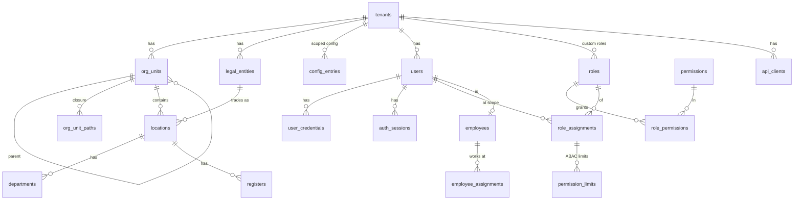
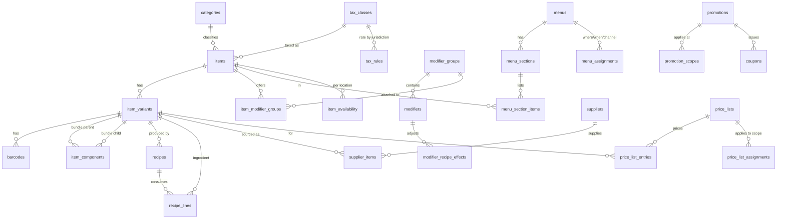
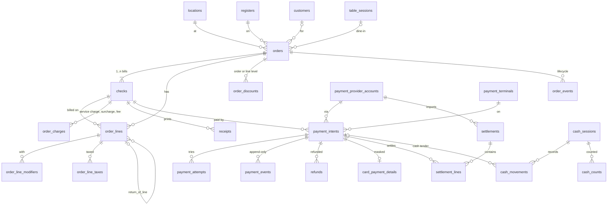
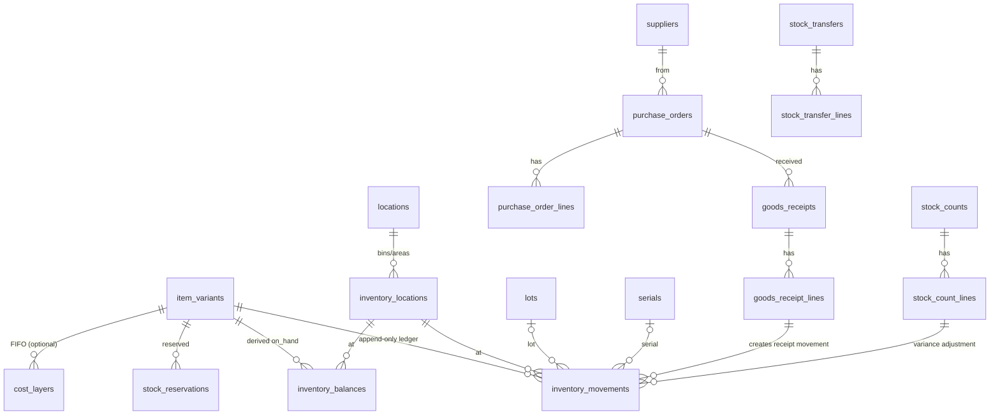
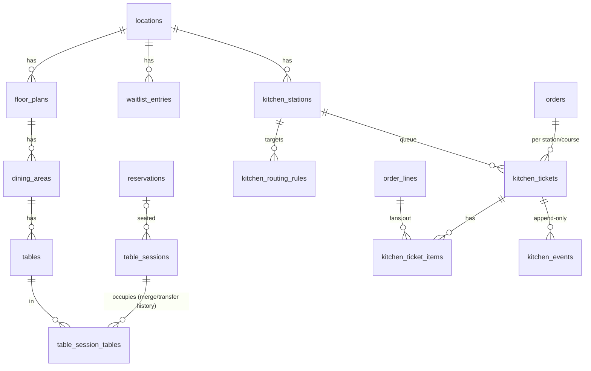
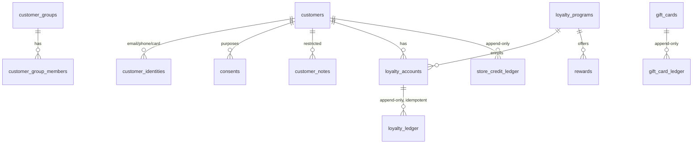
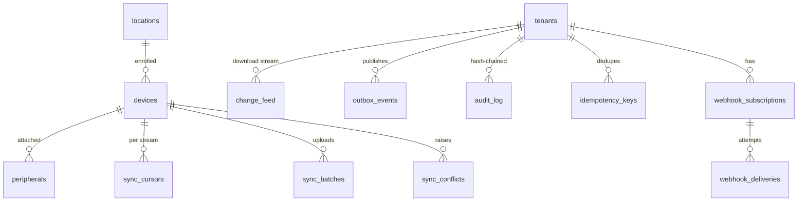

# Database Design

Target: PostgreSQL 16 (Aurora). Full DDL: [db/schema.sql](../db/schema.sql). This document explains the model, conventions and invariants; the SQL is authoritative for column detail.

---

## 1. Conventions

| Convention              | Rule                                                                                                                                                                                                                                                                                                                                                                                 |
| ----------------------- | ------------------------------------------------------------------------------------------------------------------------------------------------------------------------------------------------------------------------------------------------------------------------------------------------------------------------------------------------------------------------------------ |
| Primary keys            | `uuid` (UUIDv7, generated by the writer; `gen_random_uuid()` default as fallback)                                                                                                                                                                                                                                                                                                    |
| Tenant column           | Every tenant-owned table has `tenant_id uuid NOT NULL REFERENCES tenants(id)`, and it is the **first column of every unique constraint and most indexes**                                                                                                                                                                                                                            |
| Row-Level Security      | Enabled and **forced** on all tenant tables; policy `tenant_id = current_setting('app.tenant_id', true)::uuid`; application connects as `app_rw`, which is not the table owner; a missing setting evaluates to NULL and returns zero rows                                                                                                                                            |
| Cross-tenant references | Child tables carry composite FKs `(tenant_id, parent_id) → parent(tenant_id, id)` wherever the parent is tenant-owned, so a row cannot point at another tenant's parent even if application code is wrong                                                                                                                                                                            |
| Money                   | `*_minor bigint` in minor units; `currency char(3)` on the aggregate root. Rates and quantities are `numeric`                                                                                                                                                                                                                                                                        |
| Quantities              | `numeric(14,4)` for sold/stocked quantity (supports weight, fractional shared items)                                                                                                                                                                                                                                                                                                 |
| Time                    | `timestamptz` everywhere; `occurred_at` = business time (client), `recorded_at`/`created_at` = server time; `business_date date` computed from location time zone                                                                                                                                                                                                                    |
| Status columns          | `text` with `CHECK (… IN (…))` instead of Postgres enums, so adding a state is an expand-only migration                                                                                                                                                                                                                                                                              |
| Soft delete             | None on financial tables. Catalog/config rows use `status = 'archived'`. Ledgers are append-only (triggers forbid UPDATE/DELETE)                                                                                                                                                                                                                                                     |
| Optimistic concurrency  | `version integer NOT NULL DEFAULT 1` on mutable aggregates; `UPDATE … WHERE version = $expected`                                                                                                                                                                                                                                                                                     |
| Snapshots               | Order lines store `item_snapshot jsonb` (name, SKU, tax class, price at sale) so later catalog edits never change history                                                                                                                                                                                                                                                            |
| JSON                    | `jsonb` only for genuinely schemaless data (addresses, device capabilities, rule DSL, provider payloads); each jsonb column has a zod schema in `packages/contracts` and a comment naming it                                                                                                                                                                                         |
| Naming                  | snake_case, plural tables, `<table>_id` FKs, `idx_<table>_<cols>`, `uq_<table>_<cols>`, `chk_<table>_<rule>`                                                                                                                                                                                                                                                                         |
| Schemas                 | One `public` schema with table-name prefixes per module is **not** used; instead each module owns a Postgres schema (`identity`, `tenancy`, `catalog`, `pricing`, `inventory`, `orders`, `payments`, `cash`, `tables`, `kitchen`, `customers`, `workforce`, `devices`, `audit`, `integrations`, `reporting`, `platform`). The DDL file uses `search_path`-free fully qualified names |

---

## 2. Domain ERDs

### 2.1 Tenancy and identity

### 2.2 Catalog, menus, recipes, pricing

### 2.3 Orders, checks, payments, cash

### 2.4 Inventory

### 2.5 Restaurant floor and kitchen

### 2.6 Customers and loyalty

### 2.7 Devices, sync, audit, platform

---

## 3. Key tables and invariants

### 3.1 Tenancy

- **`org_units` + `org_unit_paths`** (closure table with `depth`). Effective permissions and config inheritance are resolved with one join on the closure table. A trigger maintains paths on insert/reparent.
- **`locations`** carry `timezone`, `currency`, `deployment_profile` (`cloud_only | device_autonomous | store_hub`), `business_day_boundary` (e.g. `04:00`).
- **`config_entries`** store `(scope_kind, scope_id, key, value jsonb, version)`. Effective value = nearest scope on the path register → department → location → org unit chain → tenant → platform default. Every change inserts a new version; previous versions remain for rollback and audit.
- **`business_days`** records open/close per location and date; closing a day locks cash sessions and is a reporting boundary.

### 3.2 Identity and access

- `users.email` is unique **per tenant**; the same person at two tenants is two users (platform operators live in `platform.operators`).
- `user_credentials.kind ∈ {password, passkey, totp, pos_pin}`; a `pos_pin` is scoped by `location_id` and stored as Argon2id hash; lockout counters are in Redis, lockout events in audit.
- `role_assignments(scope_kind, scope_id, valid_from, valid_to)` — temporary elevation is a row with `valid_to`.
- `permission_limits` attach to a role or directly to an assignment; keys are the ABAC attributes (`orders.discount.max_percent`, `orders.refund.max_minor`, …).
- `approval_requests` persist every over-limit action request with payload hash, requester, approver, decision; the order event that consumed it references the approval id.

### 3.3 Catalog

- `items.kind ∈ {product, menu_item, ingredient, service, gift_card, fee, combo}`; `items.sold_by ∈ {unit, weight, volume, length}`.
- `item_variants` are the sellable/stockable unit (SKU). Simple items have one `is_default` variant. `option_values jsonb` holds `{size:'L', colour:'Red'}` and is indexed with GIN for faceting.
- `barcodes(tenant_id, code)` unique; `pack_quantity` supports case barcodes. PLUs are barcodes of kind `plu`.
- `items.search_vector tsvector` (name, description, SKU, barcodes) plus a `pg_trgm` GIN index on `name` for fuzzy lookup → p95 < 200 ms on 1M items.
- Modifier validation is `modifier_groups.selection_min/selection_max` + `modifiers.status`; the price impact is `price_delta_minor`; inventory impact is `linked_variant_id` or `modifier_recipe_effects`.
- Menus are **assignments** `(menu_id, scope_kind, scope_id, channel, schedule jsonb, valid_from, valid_to, priority)`; the resolver picks the highest-priority active assignment for (location, channel, local time). Publishing a menu bumps `menus.version` and emits `menu.published`; devices pull by version.
- `item_availability(location_id, item_id|variant_id, is_available, snoozed_until)` is the 86'd list, independent of inventory balances (restaurants rarely track every ingredient).

### 3.4 Pricing and promotions

- `tax_rules(jurisdiction_country, jurisdiction_region, tax_class_id, rate, inclusive, valid_from, valid_to, priority)`; Australia ships as one GST 10 % rule per class (`standard`, `gst_free`, `input_taxed`) — rates are data, not code.
- `price_lists` + `price_list_entries(variant_id, price_minor, min_quantity, valid_from, valid_to)` + `price_list_assignments(scope_kind ∈ {tenant, org_unit, location, channel, customer_group, customer}, priority)`.
- `promotions.rules jsonb` is the validated DSL (conditions: items/categories/quantity/threshold/customer group/channel/schedule; effects: percent_off/amount_off/fixed_price/bogo/multibuy/bundle; stacking: `stack_group`, `exclusive`); `priority` orders evaluation deterministically.
- `order_discounts` record **what was actually applied** per order/line with `promotion_id`/`coupon_id`, so promotion reporting is a join, not a recomputation.

### 3.5 Inventory

- `inventory_movements` is the ledger. Columns: `variant_id, inventory_location_id, quantity_delta, unit_cost_minor, reason, reference_kind, reference_id, lot_id, serial_id, performed_by, device_id, occurred_at, recorded_at`. **Append-only trigger.** `reason ∈ {sale, return, receipt, transfer_out, transfer_in, adjustment, count_variance, waste, damage, write_off, production_in, production_out, recipe_consumption, reservation_release, opening_balance}`.
- `inventory_balances(variant_id, inventory_location_id)` PK; `on_hand`, `reserved`, `avg_cost_minor`, `last_movement_id`. Updated in the same transaction as the movement. Check constraint `on_hand >= 0` is **per tenant policy** (`allow_negative_stock` config) — enforced in the application because a constraint cannot be conditional; the nightly proof job reports negatives.
- `stock_reservations(variant_id, inventory_location_id, quantity, reference_kind, reference_id, expires_at, status)`; `reserved` on the balance is the sum of active reservations (also proven nightly).
- Purchasing: `purchase_orders` → `purchase_order_lines`; `goods_receipts` → `goods_receipt_lines` → each line creates one `receipt` movement with `unit_cost_minor` (landed cost allocation updates cost without new quantity via `adjustment` movements with `quantity_delta = 0` and a cost delta column).
- `stock_counts(kind ∈ {cycle, full}, is_blind)` → `stock_count_lines(expected_qty, counted_qty)`; approving a count writes `count_variance` movements.
- `cost_layers` (FIFO) is optional and only populated for tenants with `costing_method = 'fifo'`.

### 3.6 Orders and checks

- `orders` unique `(tenant_id, location_id, order_number)`; `order_number` assigned from `order_number_sequences(location_id, business_date)` on the server; `client_order_ref` keeps the offline register-local number.
- Three status columns (`status`, `fulfillment_status`, `payment_status`) with check constraints; totals columns are **denormalized and recomputed by domain-core on every mutation** inside the transaction, never by SQL triggers (so client and server agree).
- `order_lines.check_id` NOT NULL → every line is on exactly one check; moving a line between checks is an update with `order_events` record. Fractional `quantity` supports shared items.
- `order_lines.status ∈ {active, voided, returned, cancelled}`; voids keep the row (reporting needs voids), with `void_reason`, `voided_by`, `void_approval_id`.
- `order_lines.return_of_line_id` links return lines to originals; a partial check `returned_quantity <= quantity` on the original is maintained in the same transaction.
- `order_events` is append-only and is the auditable lifecycle (`kind`: created, line_added, line_voided, discount_applied, placed, fired, suspended, resumed, check_split, check_merged, payment_applied, completed, voided, returned …) with actor, device, approval id, payload.
- `receipts(check_id, kind ∈ {sale, refund, reprint, gift, proforma}, number, rendered_uri, delivered_via, printed_count)`; reprints create new rows (audit requirement).

### 3.7 Payments

- `payment_intents.status ∈ {created, processing, authorized, captured, partially_refunded, refunded, reversed, failed, cancelled, uncertain}`; `settlement_status ∈ {unsettled, settled, disputed}`; `idempotency_key` unique per tenant; `offline boolean` and `settlement_pending` flag.
- `payment_attempts` capture each provider round trip with redacted request/response (`jsonb`, PII/PAN never present) and `provider_request_id`.
- `payment_events` append-only; the intent status is a projection and a nightly job replays events to prove it.
- `refunds` are first-class rows referencing the intent (and order) with their own state; `refunded_minor` on the intent is the sum of succeeded refunds.
- `card_payment_details` stores only scheme-approved receipt data: brand, last4, auth code, entry mode, AID, token/scheme reference. **No PAN, no CVV, no track data, no expiry** (constraint comments make this explicit; a CI check scans column names).
- `webhook_inbox(provider, external_event_id)` unique; signature result, `received_at`, `processed_at`, `status` → replay-safe processing.
- `settlements`/`settlement_lines` from provider files; `reconciliation_exceptions(kind ∈ {missing_in_settlement, missing_in_platform, amount_mismatch, fee_mismatch, duplicate_capture_suspected, uncertain_aged})`.

### 3.8 Cash

- `cash_sessions(register_id, drawer_id, opened_by, opening_float_minor, expected_minor, counted_minor, variance_minor, status ∈ {open, closing, closed, approved}, business_date)`.
- `cash_movements` append-only: `kind ∈ {sale, refund, change, paid_in, paid_out, float_in, float_out, drop, transfer_in, transfer_out, adjustment, rounding}`; cash tenders reference the `payment_intent_id`. `expected_minor` = opening float + Σ movements, recomputed and proven on close.
- `cash_counts(kind ∈ {opening, mid, closing}, is_blind, denominations jsonb, total_minor)`.

### 3.9 Tables and reservations

- `tables.geometry jsonb` `{x, y, w, h, rotation, shape}`; `status ∈ {available, occupied, reserved, dirty, blocked}` is a projection of sessions/reservations and is updated transactionally.
- `table_sessions` (a seating) own orders (`orders.table_session_id`). `table_session_tables(session_id, table_id, from_at, to_at)` records which physical tables a session occupied, so **merge** = multiple rows active, **transfer** = close one row open another, **split** = new session with moved checks.
- `reservations` with `tstzrange` `slot` and an exclusion constraint per `assigned_table_id` via the `reservation_tables` link table (`EXCLUDE USING gist (table_id WITH =, slot WITH &&) WHERE (status IN ('confirmed','seated'))`) prevents double booking at the database.

### 3.10 Kitchen

- `kitchen_tickets(order_id, station_id, course_number, ticket_number, status, priority, fired_at, target_ready_at, acknowledged_at, ready_at, bumped_at)`.
- `kitchen_ticket_items(ticket_id, order_line_id, quantity, status, modifiers_snapshot jsonb, allergen_flags text[])`; status transitions only through `kitchen_events` (append-only, with `from_status/to_status`, actor, device). A ticket item cannot be deleted; it is `cancelled` with an event.
- `kitchen_station_cursors(station_id, device_id, last_event_seq)` support replay for at-least-once delivery.

### 3.11 Customers and loyalty

- `customers` PII columns (`email`, `phone`, `date_of_birth`) are stored **encrypted application-side** (`bytea`) with blind-index columns (`email_hash`, `phone_hash`) for lookup; `customer_identities` provide additional lookup keys (loyalty card, ecommerce id).
- `consents(purpose, granted, source, recorded_at, expires_at)` are append-only; current consent = latest row per purpose.
- `loyalty_ledger(account_id, delta_points, kind, order_id, idempotency_key UNIQUE, expires_at)`; earn on `order.completed` with key `earn:<order_id>`; reversal on refund with `reverse:<refund_id>`; duplicate retries hit the unique index and no-op. Balance is a projection with nightly proof.
- `gift_cards(code_hash, code_last4, balance_minor)` + `gift_card_ledger` append-only; the code is never stored in clear.

### 3.12 Devices and sync

- `devices(kind, platform, app_version, enrollment_status, public_key, last_seen_at, health jsonb)`; enrollment via one-time `device_enrollment_codes`.
- `sync_batches(device_id, client_batch_id UNIQUE, status, results jsonb)`; `sync_commands_processed(device_id, client_command_id)` PK for command idempotency.
- `change_feed(seq bigserial, tenant_id, location_id, stream, entity, entity_id, op, version, payload jsonb, occurred_at)` is written by the outbox relay (or triggers for catalog/config) and read by devices with `WHERE tenant_id = $1 AND (location_id IS NULL OR location_id = $2) AND stream = ANY($3) AND seq > $cursor ORDER BY seq LIMIT n`. Partitioned monthly, retained 90 days; devices older than that bootstrap from snapshot.
- `sync_conflicts(kind ∈ {pricing_mismatch, stale_edit, permission_rejected, duplicate_order_number, unknown_entity}, client_payload, server_payload, resolution, resolved_by)`.

### 3.13 Audit and platform

- `audit_log` append-only, partitioned monthly: `actor_kind ∈ {user, device, system, api_client}`, `action`, `resource_type`, `resource_id`, `before`, `after`, `reason`, `approval_id`, `prev_hash`, `hash`. Hash chain is **per tenant**; the application computes `hash` under a per-tenant advisory lock to serialize appends.
- `idempotency_keys(tenant_id, scope, key)` PK with `request_hash`, `response_status`, `response_body`, `expires_at` (24 h default).
- `outbox_events` partitioned daily by `occurred_at`, purged 7 days after `published_at`.
- `processed_events(consumer, event_id)` PK for consumer idempotency.

### 3.14 Reporting read models

`reporting.rm_sales_daily(tenant_id, location_id, business_date, channel, order_kind, currency, order_count, gross_minor, discount_minor, refund_minor, net_minor, tax_minor, tip_minor, service_charge_minor, void_count, void_minor)` and siblings (`rm_item_sales_daily`, `rm_payment_method_daily`, `rm_cash_variance_daily`, `rm_kitchen_times_daily`, `rm_inventory_valuation_daily`). Upserted by idempotent consumers keyed on `(…, business_date)`; a `freshness(stream, last_event_seq, last_event_at)` table feeds the UI's "data as of" indicator.

---

## 4. Indexing strategy (highlights)

| Table                 | Index                                                                                                                                                                                            | Purpose                                              |
| --------------------- | ------------------------------------------------------------------------------------------------------------------------------------------------------------------------------------------------ | ---------------------------------------------------- |
| `barcodes`            | `UNIQUE (tenant_id, code)`                                                                                                                                                                       | Scan lookup                                          |
| `items`               | GIN `search_vector`; GIN trgm `lower(name)`; `(tenant_id, status, category_id)`                                                                                                                  | Search                                               |
| `item_variants`       | `UNIQUE (tenant_id, sku)`; GIN `option_values`                                                                                                                                                   | SKU lookup, faceting                                 |
| `orders`              | `(tenant_id, location_id, business_date)`, `(tenant_id, location_id, status) WHERE status IN ('open','suspended')`, `(tenant_id, customer_id, created_at DESC)`, `(tenant_id, table_session_id)` | Day reports, open-order board, customer history      |
| `order_lines`         | `(tenant_id, order_id)`, `(tenant_id, check_id)`, `(tenant_id, variant_id, created_at)`                                                                                                          | Order load, check load, product sales                |
| `payment_intents`     | `UNIQUE (tenant_id, idempotency_key)`, `(tenant_id, check_id)`, `(tenant_id, status) WHERE status IN ('processing','uncertain')`, `(provider_account_id, provider_reference)`                    | Dedupe, settle, stuck-payment sweeper, webhook match |
| `inventory_movements` | `(tenant_id, variant_id, inventory_location_id, occurred_at)`, `(tenant_id, reference_kind, reference_id)`                                                                                       | Ledger reads, traceability                           |
| `kitchen_tickets`     | `(tenant_id, station_id, status, fired_at) WHERE status NOT IN ('bumped','cancelled')`                                                                                                           | Station queue                                        |
| `change_feed`         | `(tenant_id, stream, seq)`, `(tenant_id, location_id, stream, seq)`                                                                                                                              | Device download                                      |
| `audit_log`           | `(tenant_id, occurred_at)`, `(tenant_id, resource_type, resource_id)`                                                                                                                            | Audit browse                                         |

---

## 5. Partitioning and growth

| Table                                                                                           | Strategy                                                                                             | When                                                                                                              |
| ----------------------------------------------------------------------------------------------- | ---------------------------------------------------------------------------------------------------- | ----------------------------------------------------------------------------------------------------------------- |
| `audit_log`, `outbox_events`, `change_feed`, `payment_events`, `order_events`, `kitchen_events` | Range by month on `occurred_at` (`pg_partman`)                                                       | From day one (append-only, no FKs pointing at them)                                                               |
| `inventory_movements`                                                                           | Range by month                                                                                       | From day one; FK from `inventory_balances.last_movement_id` is dropped in favor of a plain column for that reason |
| `orders`, `order_lines`, `payment_intents`                                                      | Unpartitioned initially; hash partition by `tenant_id` (or move large tenants to dedicated clusters) | When the largest table exceeds ~500 M rows or vacuum lag becomes visible                                          |
| Read replicas                                                                                   | 1 for reporting/exports from Phase 1; `api` reads of catalogs may use replicas with staleness budget | Phase 1                                                                                                           |

---

## 6. Migrations

- Tool: Drizzle Kit generates SQL; every migration is reviewed as SQL and committed under `packages/db/migrations/NNNN_description.sql`.
- **Expand/contract** only: add column → deploy code that writes both → backfill in batches → switch reads → drop old in a later release.
- No `ALTER TABLE … SET NOT NULL` on large tables without `CHECK … NOT VALID` + `VALIDATE` two-step.
- Each migration has a rollback file or is explicitly marked irreversible (destructive migrations require a data export step first).
- Migrations run as a dedicated ECS task before rollout; the app refuses to start if `schema_version` is behind.
- Device SQLite migrations ship with the app and are versioned independently; the sync protocol carries `schema_version` so the server can refuse or adapt payloads from old clients.

---

## 7. Data retention and privacy

| Data                                     | Default retention                                                                                                                                 | Notes                                                        |
| ---------------------------------------- | ------------------------------------------------------------------------------------------------------------------------------------------------- | ------------------------------------------------------------ |
| Orders, payments, cash, inventory ledger | 7 years (AU tax record keeping)                                                                                                                   | Tenant/region configurable, never shorter than legal minimum |
| Audit log                                | 7 years, hash chain anchored                                                                                                                      |                                                              |
| Customer PII                             | Until erasure request or inactivity policy; erasure pseudonymizes `customers` and keeps financial rows with `customer_id` pointing to a tombstone | GDPR/APP erasure                                             |
| `change_feed`, `outbox_events`           | 90 / 7 days                                                                                                                                       | Operational                                                  |
| Webhook inbox payloads                   | 90 days                                                                                                                                           | Debugging                                                    |
| Device telemetry                         | 30 days                                                                                                                                           |                                                              |

---

## 8. Proof jobs (nightly, per tenant)

1. `Σ inventory_movements` = `inventory_balances.on_hand` per (variant, location).
2. `Σ active stock_reservations` = `inventory_balances.reserved`.
3. Replay `payment_events` ⇒ `payment_intents.status`.
4. `Σ captured − refunded` per check ⇒ `checks.paid_minor` and `orders.payment_status`.
5. `Σ cash_movements` + opening float ⇒ `cash_sessions.expected_minor`.
6. `Σ loyalty_ledger` ⇒ `loyalty_accounts.points_balance`; same for gift cards and store credit.
7. `rm_*` daily totals ⇒ raw order/payment sums per business date.
8. Audit chain verification for the day's partition.

Every mismatch creates a `reconciliation_exceptions` row and an alert. Nothing is auto-corrected.
