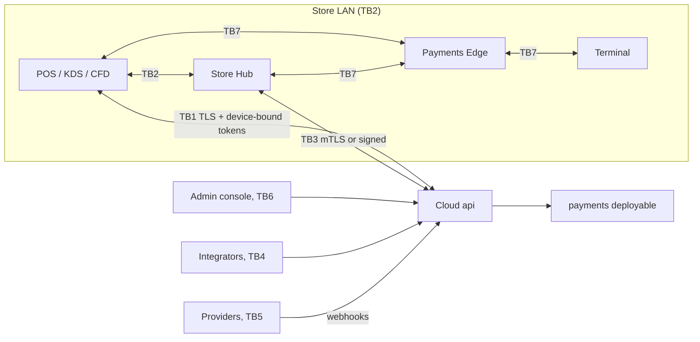

# Threat model v1

Status: **v1 proposal for security-engineer review** (Sprint 0 deliverable "Threat model v1", [03 §4](../03-implementation-plan.md): *STRIDE on the architecture, abuse cases for POS; reviewed by security engineer; mitigations mapped to slices*). Written 2026-10-18 against the architecture as designed ([01 §11](../01-system-architecture.md)) and against the F1 code as described in [releases/f1.md](../releases/f1.md) and read in the repository. Nothing here has been reviewed by a security engineer or a QSA yet; ratings are the author's judgement.

Related: [ADR-002](../adr/ADR-002.md), [ADR-009](../adr/ADR-009.md), [ADR-010](../adr/ADR-010.md), [ADR-011](../adr/ADR-011.md), [ADR-019](../adr/ADR-019.md), [capability matrix](../payments/capability-matrix.md), [supported devices](../operations/supported-devices.md), [store onboarding](../operations/store-onboarding.md), [device provisioning](../operations/device-provisioning.md).

## 1. Scope, method and conventions

**In scope:** cloud core (`api`, `worker`, `payments`), POS/KDS/CFD apps, Store Hub, Payments Edge, terminals as seen from the platform, admin console, public API and webhooks, enrollment and provisioning.
**Out of scope for v1:** provider-internal security (Adyen, Stripe, Tyro, Linkly, Windcave), AWS control plane, physical store premises beyond what the platform can verify, handheld app (Phase 3), AI layer (Phase 4).

**Method:** STRIDE (Spoofing, Tampering, Repudiation, Information disclosure, Denial of service, Elevation of privilege) per trust boundary (§3), then POS-specific abuse cases (§4) because fraud by authorised users is the dominant loss in this domain and STRIDE alone under-weights it.

**Rating scales** (qualitative, to be recalibrated with incident data from the pilot):

| Rating | Likelihood | Impact |
| --- | --- | --- |
| H | Expected within a year of operation across a pilot-to-GA fleet; low skill or opportunistic | Money loss beyond one store, cross-tenant exposure, card-data exposure, or loss of trust |
| M | Plausible with a motivated insider or skilled outsider | Single-tenant financial loss or data exposure, or multi-store outage |
| L | Needs unusual access or multiple failures | Single-store inconvenience or small loss |

**Mitigation status:** **Impl** = implemented and tested in the repository as of the F1 release note; **Design** = in the architecture, not yet built; **Gap** = not in the architecture or not sufficient. Every gap maps to a slice in [03](../03-implementation-plan.md) (slice ids F1–F10, M1–M13, Sprint 0, Phase 3/4) and to an owning stream from [03 §15.1](../03-implementation-plan.md); the consolidated list is §5.

## 2. Assets and actors

| Asset | Why it matters | Where it lives |
| --- | --- | --- |
| Cash and card revenue (orders, payments, refunds, tips) | Direct financial loss | `orders`, `payments` schemas, Payments Edge queue, offline command log |
| Cardholder data (PAN, CVV, track) | PCI scope; **must never reach the platform** | Terminal only ([01 §7.4](../01-system-architecture.md)) |
| Tenant data (customers, prices, stock, staff) | Cross-tenant disclosure is a P1 | Aurora (RLS), read models, S3 exports, device SQLite, Hub SQLite |
| Credentials and keys (JWT signing key, `AUTH_SECRETS_KEY`, device private keys, provider API keys, webhook secrets, Hub certificate) | Compromise defeats other controls | Secrets Manager, OS keychain/Keystore, Hub disk |
| Audit log and payment events | Evidence; non-repudiation | `audit.audit_log` (hash chain), `payment_events` |
| Configuration (roles, limits, tax, price lists, promotions) | Lever for fraud and for privilege escalation | `tenancy.config_entries`, `identity.*`, `pricing.*` |

| Actor | Capability assumed |
| --- | --- |
| External attacker (internet) | Reaches public API, webhook endpoints, login |
| Customer / bystander in store | Physical access to CFD, terminal, receipts; same Wi-Fi if guest network is not separated |
| Cashier / server | Authorised POS user with PIN; wants refunds, voids, discounts, cash |
| Store manager | Holds approvals within limits |
| Tenant administrator | Holds `*.admin`; MFA enforced |
| Malicious or compromised integrator | Valid OAuth client with scopes |
| Rogue device on store LAN | Can run mDNS responders, ARP spoof, replay traffic |
| Compromised register or Hub | Attacker controls app binary or OS on a device |
| Platform operator / insider | Operator tokens, deploy rights, DB role access |
| Provider (webhook sender, impersonated) | Source of inbound events |

## 3. Trust boundaries and STRIDE analysis

| Boundary | Name | Authentication in the design |
| --- | --- | --- |
| TB1 | Device ↔ cloud (sync, orders, auth) | TLS 1.2+, certificate pinning (with rotation plan), device Ed25519 key + signed challenge, device token 24 h, POS user session 60 min bound to the device ([01 §11](../01-system-architecture.md), F1) |
| TB2 | Device ↔ Store Hub (LAN) | Design only: "mTLS or signature for Store Hub" ([01 §5.1](../01-system-architecture.md)); mDNS `_unifiedpos._tcp` discovery |
| TB3 | Store Hub ↔ cloud | mTLS or signed requests; same command protocol as a device |
| TB4 | Public API | OAuth 2.0 client credentials with scopes, `Idempotency-Key`, rate limits |
| TB5 | Webhooks (inbound from providers; outbound to tenants) | Signature, replay window, inbox dedupe (in); HMAC-SHA256 `timestamp.body`, 5 min tolerance (out) |
| TB6 | Admin console ↔ cloud | Web session 15 min (refresh 12 h sliding, 30 d absolute), TOTP/passkey MFA for privileged roles |
| TB7 | Payments Edge ↔ terminal (and Edge ↔ POS/Hub) | Provider-specific: Adyen local TLS with Adyen root certificate and encrypted messages, Stripe SDK pairing/connection tokens, Tyro iClient pairing; Edge ↔ cloud via command log |

Threat ids are `T<boundary>.<n>`. "Gap" entries cite the slice in §5.

### 3.1 TB1: Device ↔ cloud

| Id | STRIDE | Threat | L | I | Existing mitigation | Gap → slice |
| --- | --- | --- | --- | --- | --- | --- |
| T1.1 | S | Attacker enrols a rogue device with a stolen or guessed enrollment code | M | M | One-time codes `<slug>.<12 Crockford chars>`, 15 min TTL, `FOR UPDATE` consume, audit `devices.enrolled`, requires `devices.enroll` at the location to issue (**Impl**, [F1](../releases/f1.md)); public rate-limit bucket per IP (**Impl**) | No per-code or per-IP failed-enrollment alert; code shown unmasked in admin; no attestation of the enrolling device → F8 (UI hygiene), F10 (alerts), G-12 |
| T1.2 | S | Device private key copied from a stolen register and used elsewhere | M | H | Key in OS keychain/Keystore; revocation check on each token (60 s cache); revoke kills sessions (**Impl** revoke; **Design** storage) | Hardware-backed keys and app attestation not specified → F6 (G-12) |
| T1.3 | S | Stolen device token or POS session replayed | M | M | Device token 24 h, POS 60 min, refresh rotation with reuse detection revoking the session (**Impl**) | None beyond G-12 |
| T1.4 | T | Tampered client sends commands with altered totals, prices, discounts, timestamps | H | H | Server re-executes every command through the application service, re-prices with `domain-core`, `pricing_mismatch` conflict, limits and approvals ([01 §8.2](../01-system-architecture.md), **Design**) | Server endpoints are M1; sync bounds on `hlc`/`occurred_at`, offline discount caps → M1 (G-10, G-13) |
| T1.5 | T | Man-in-the-middle on store Wi-Fi or hostile network | L | H | TLS 1.2+, certificate pinning (**Design**) | Pinning rollout and rotation plan → F6 (G-17) |
| T1.6 | R | Cashier denies a void, refund or reprint | M | M | Hash-chained audit with actor, device, reason; reprints logged; approvals record approver ([01 §11](../01-system-architecture.md); audit **Impl** in F1) | Reprint/refund audit lives in F4/M3; anchoring chain head to S3 Object Lock deferred → G-03 (F9/F10) |
| T1.7 | I | Lost device exposes local data (catalog, staff PIN hashes, customer subset, command log) | H | M | SQLCipher, key in keychain/Keystore; revocation; remote wipe on next contact ([01 §8.4](../01-system-architecture.md)) | Wipe command not found in the F1 API (status `wiped` exists in the enum only) → F6/F8 (G-15) |
| T1.8 | I | Tokens, enrollment codes, PINs leak through logs and traces | M | H | PII redaction at source; structured logs ([01 §13](../01-system-architecture.md), **Design**) | Automated log-redaction test and PCI/PII column-name scanner → S-INFRA, F10 (G-22) |
| T1.9 | D | Login/PIN brute force and token endpoint flooding | M | M | Redis token-bucket rate limit as first guard (300 burst, 100/s per principal; 60/10 per IP public; POS fails open, others closed) (**Impl** follow-up); PIN lockout 5/15 min per user per location and 50 per device (**Impl**); password lockout 5/15 min (**Impl**) | Fail-open for POS tokens is a deliberate trade-off; revisit after load test → F10 |
| T1.10 | D | Sync flood or oversized batch from a compromised device | M | M | Batch processing per command in its own transaction | Limits on batch size, per-device sync rate, storage quota enforcement → M1 (G-13) |
| T1.11 | E | A device token used on endpoints for other locations | M | H | ScopeGuard: tenant from verified token only, location/register within assignments else 404; device principals bound to location (**Impl**); cross-tenant harness 146 cases (**Impl**) | Sync, Hub and Edge paths are not yet covered by the harness → M1, M8a (G-20) |

### 3.2 TB2: Device ↔ Store Hub (LAN)

| Id | STRIDE | Threat | L | I | Existing mitigation | Gap → slice |
| --- | --- | --- | --- | --- | --- | --- |
| T2.1 | S | Rogue device advertises `_unifiedpos._tcp` or answers mDNS and impersonates the Hub; POS sends open checks or kitchen tickets to the attacker | M | H | None specified beyond "mTLS or signature" ([01 §5.1](../01-system-architecture.md)); static-address fallback ([01 §12.2](../01-system-architecture.md)) | **Gap:** Hub identity must not rest on mDNS. Proposed control: Hub certificate (or public key) delivered inside the authenticated enrollment response and pinned by devices; discovery only yields a candidate address, the TLS handshake decides → M8a (G-01) |
| T2.2 | S | Rogue device on the LAN poses as a POS to the Hub | M | H | Hub expects device-key-signed requests (**Design**); F1 deferred "the Store Hub signature path" | Per-request device signature or mTLS with device certificates → M8a (G-01) |
| T2.3 | T | LAN attacker modifies kitchen tickets or checks in transit | M | M | None unless TB2 uses TLS | TLS mandatory on TB2, plain HTTP refused → M8a (G-01) |
| T2.4 | T | Replay of captured device→Hub commands | M | M | Idempotency on `client_command_id`, HLC (**Design**) | Hub must apply server-style validity checks and reject stale replays outside an expected window → M8b |
| T2.5 | I | Customer or attacker on a shared Wi-Fi reads LAN traffic or reaches the Hub, printers and terminals | M | H | One-subnet requirement ([01 §12.2](../01-system-architecture.md), docs/05 G7) *increases* exposure if the subnet is shared with guest devices | **Gap:** onboarding must require a dedicated store VLAN/SSID separate from guest Wi-Fi, with the terminals and printers on it ([store-onboarding §4](../operations/store-onboarding.md), [supported-devices §8](../operations/supported-devices.md)); enrollment-time check proposes a guest-network heuristic → F6 (preflight), M8a (G-30) |
| T2.6 | I | Printers and drawer controllers on the LAN accept unauthenticated jobs (ESC/POS on TCP 9100) | M | L | None; physical and LAN control | Document as an accepted residual risk; segment printers → onboarding (G-30) |
| T2.7 | D | Flooding Hub or killing the Hub process | M | M | Device fallback to Cloud or device-autonomous; printer fallback ([01 §8.4](../01-system-architecture.md)) | Hub failover (Phase 3 item 14) |
| T2.8 | E | A compromised POS uses Hub authority to edit checks it does not own | L | M | Hub is authoritative for open checks; non-owner devices view or append only ([01 §8.2](../01-system-architecture.md)) | Ownership enforced server-side in Hub with tests → M8b |

### 3.3 TB3: Store Hub ↔ cloud

| Id | STRIDE | Threat | L | I | Existing mitigation | Gap → slice |
| --- | --- | --- | --- | --- | --- | --- |
| T3.1 | S | Stolen Hub credentials used to upload commands for the location, or to download another tenant's feed | L | H | Hub enrolled as a device (`kind = store_hub`) with the same key mechanics; feed filtered by tenant/location (**Impl** for device principals) | Hub certificate storage on a dedicated box vs primary register; hardware-backed key where possible → M8a (G-02) |
| T3.2 | T | Hub operator alters SQLite and uploads falsified facts | L | H | Server re-validates each command; audit; nightly proofs ([ADR-013](../adr/ADR-013.md)) | Proof jobs deferred in F1 → F9/F10 (G-03) |
| T3.3 | I | Hub disk stolen | M | M | SQLCipher, key in OS keychain ([01 §8.1](../01-system-architecture.md)) | Appliance disk encryption and secure boot requirements → [supported-devices §8](../operations/supported-devices.md), M8a (G-02) |
| T3.4 | D | Cloud unreachable; Hub accumulates | M | L | By design (profile C) | None |

### 3.4 TB4: Public API

| Id | STRIDE | Threat | L | I | Existing mitigation | Gap → slice |
| --- | --- | --- | --- | --- | --- | --- |
| T4.1 | S | Leaked client credentials | M | M | Client credentials, scopes, 30 min token; revocation by client status (**Impl**) | Secret rotation UX, last-used display → Phase 3 item 13 |
| T4.2 | T | Replayed or duplicated POST | M | M | `Idempotency-Key` with request hash and replay response, 409 in flight, 422 mismatch (**Impl**) | None |
| T4.3 | I | IDOR across tenants or scopes via object ids | H (most common API bug) | H | RLS, scope-pinned repositories, 404 on out-of-scope, OpenAPI-driven cross-tenant harness (146 cases, 2 scenarios) (**Impl**) | Harness must auto-cover new routes from the other streams' modules (S-F2…S-F8) in CI → S-INFRA, F10 |
| T4.4 | I | Verbose errors leak schema | L | M | `GlobalExceptionFilter` maps pg errors to 404/409/422 without constraint names (**Impl**) | None |
| T4.5 | D | Scraping and flood from a valid client | M | M | Per-principal token bucket (**Impl**) | `api_clients.rate_limit_per_minute` not enforced yet → F10 (G-04) |
| T4.6 | E | Scope creep: client uses a scope to reach another resource | L | H | `x-permission` and scope pinning in OpenAPI contract, authorization in service layer (**Impl**) | None |

### 3.5 TB5: Webhooks

| Id | STRIDE | Threat | L | I | Existing mitigation | Gap → slice |
| --- | --- | --- | --- | --- | --- | --- |
| T5.1 | S | Forged inbound provider webhook marks a payment captured | M | H | `verifyWebhook(headers, rawBody, secret)`, signature + replay window + inbox dedupe ([01 §7.3, §11](../01-system-architecture.md), **Design**); "paid only on captured" invariant | Built in F5 (S-F5): signature on raw body, constant-time compare, per-provider secret per tenant account, forged signature logged → F5 (G-05) |
| T5.2 | T | Replayed webhook | H | M | Inbox dedupe by provider event id; handlers idempotent (**Design**) | F5 acceptance includes "webhook replay is a no-op" |
| T5.3 | T | Out-of-order or delayed webhooks produce wrong state | M | M | Events append-only, status is a projection, `getStatus` for `uncertain` | Chaos tests (plan §9) |
| T5.4 | R | Provider disputes an event never recorded | L | M | Webhook inbox stores raw body | Retention policy → F5 |
| T5.5 | I | Outbound webhook delivered to attacker-controlled URL or contains excess data | M | M | HMAC, delivery log (**Design**) | URL validation (no private ranges, SSRF), payload minimisation → Phase 3 item 13 (G-06) |
| T5.6 | D | Webhook endpoint flooded with forged requests | H | L | Public rate limit per IP (**Impl**); WAF at edge (**Design**) | Cheap-reject before DB (verify signature first) → F5 |

### 3.6 TB6: Admin console

| Id | STRIDE | Threat | L | I | Existing mitigation | Gap → slice |
| --- | --- | --- | --- | --- | --- | --- |
| T6.1 | S | Phished admin credentials | M | H | Argon2id, TOTP/passkeys mandatory for `*.admin` and `finance.*` roles (`mfa_required`), session lockout (**Impl**) | Passkey-only policy option and step-up for sensitive actions → F8 (G-27) |
| T6.2 | S | Operator endpoints (tenant provisioning) abused | L | H | `AUTH_OPERATOR_TOKENS` static bearer tokens, interim until IdP decision (**Impl** interim) | **Gap:** static operator tokens have no MFA, rotation or per-use audit; IdP decision (plan §13 #2) must land before pilot → F10 (G-26) |
| T6.3 | T | Stored XSS in item names, notes, receipt templates reaching other admins or POS | M | H | Output encoding, CSP ([01 §11](../01-system-architecture.md), **Design**) | Receipt template sandboxing, sanitisation tests → F8, F4 |
| T6.4 | R | Admin changes prices or roles without trace | M | M | Every write audited with before/after ([03 §5 F8](../03-implementation-plan.md)) | None |
| T6.5 | I | Export or report leaks other tenants' data, or a signed S3 URL is shared | M | H | RLS on read models; exports tenant-scoped to S3 | Short-lived signed URLs, download audit → F9 (G-29) |
| T6.6 | E | Admin grants themselves or another user broader roles | M | H | `access.assignment.grant` required at the scope; first admin provisioning; audit (**Impl**) | **Gap:** no grant ceiling (granter's own permissions are not compared with the role being granted) and no dual approval ([01 §11](../01-system-architecture.md) names dual approval for "user role grant with admin") → see AC-8, F8 (G-19) |

### 3.7 TB7: Payments Edge ↔ terminal (and Edge ↔ POS/Hub)

| Id | STRIDE | Threat | L | I | Existing mitigation | Gap → slice |
| --- | --- | --- | --- | --- | --- | --- |
| T7.1 | S | Terminal impersonation or a rogue terminal paired to the Edge | L | H | Provider pairing (Adyen TLS/root certificate; Stripe connection token; Tyro pairing) | Terminal inventory with serials, pairing audit, physical tamper inspection (PCI 9.5) → F5 (terminals table), onboarding (G-24) |
| T7.2 | T | Altered amount between POS and terminal (POS asks for 1.00 but order total is 100.00) | M | H | Amount authority is the order total; Edge builds the request from the intent; attempt events record request amount and terminal approved amount ([01 §7.3](../01-system-architecture.md), **Design**) | Reconcile terminal-approved amount to intent amount at the Edge and in nightly proof → F5 |
| T7.3 | T | Offline caps bypassed by editing local counters or clock | M | H | Caps enforced at the Edge from `devices.health` counters, proven nightly against `offline_device_seq`; provider also enforces its own caps (Adyen Support limits, Stripe USD 10,000) ([ADR-019](../adr/ADR-019.md)) | Counter integrity under tamper: terminal-side limits are the real control; document merchant liability → M11 (G-10) |
| T7.4 | R | Merchant disputes offline decline responsibility | M | M | Forward-outcome lifecycle and manager queue ([01 §8.3](../01-system-architecture.md)) | UI copy and terms: terminal decides, merchant bears risk → M11 |
| T7.5 | I | PAN leaks via Edge logs, receipts, error messages | L | H | Platform never receives PAN; masked data only; PCI column-name scanner | Scanner not yet in CI → S-INFRA (G-22); terminal receipt text may contain data, review field list |
| T7.6 | D | Terminal offline or locked | H | L | `uncertain` handling, `lastTransactionResult()`, fall back to other tender | None |
| T7.7 | E | Compromised register uses the Edge to refund to an arbitrary card (unreferenced refund) | M | H | Provider options: Adyen supports unreferenced refunds, Linkly TCP/IP does not, Windcave needs a merchant refund card ([capability matrix](../payments/capability-matrix.md)) | Unreferenced refunds disabled by default and behind `orders.refund` limits plus approval → M3 (G-09) |

## 4. POS abuse cases

Each case is written so a test can be derived from it. "Existing mitigation" cites the architecture section; status labels as in §1.

### AC-1 Refund and void fraud

**Scenario.** A cashier voids a completed sale after taking cash and pocketing it; processes a refund to their own card using an unreferenced refund; issues repeated small refunds under the approval limit ("structuring"); refunds goods that were never sold; collusion between cashier and manager approver.
**Likelihood H, Impact H** (the largest dollar loss class in retail and hospitality).

| Existing mitigation | Status |
| --- | --- |
| Voids need `orders.void` or an approval; refunds above `orders.refund.max_minor` need approval; approver must hold the underlying permission within their own limits, cannot self-approve; approval consumption is hash-checked and expires in 15 minutes ([01 §6.3](../01-system-architecture.md)); approvals **Impl** in F1, voids F4, refunds M3 | Impl (approvals); Design (void/refund use) |
| Returns are new orders linked to the original line (`return_of_line_id`), so refunds cannot exceed the original and double refunds are joinable ([01 §7.1](../01-system-architecture.md)); provider-referenced refunds cannot exceed the original (Adyen) | Design (M3) |
| Audit of all voids, refunds, reprints with actor, device, reason; refund/void pattern detection and cash variance alerts ([01 §11](../01-system-architecture.md)) | Audit Impl; pattern detection Design |
| Dual approval option for refund over threshold ([01 §11](../01-system-architecture.md)) | Design |

**Gaps.** (a) Pattern detection is only named; there is no rule list: propose baseline rules (refund rate per user per shift above tenant percentile, voids after payment, refund to a card not used in the original, refunds just under limit, same approver for the same cashier above N per day) → F9 exception reports, M6 cash alerts, M12 refunds/voids analysis (G-07). (b) No-receipt returns policy, unreferenced refund policy and per-provider support → M3 (G-09). (c) Collusion cannot be prevented, only detected: approver/cashier pair analytics → M12.
**Slices:** F4 (void), M3, M6, M12, Phase 4 (fraud detection).

### AC-2 Discount abuse

**Scenario.** Cashier applies maximum manual discount to friends' purchases; stacks promotions to exceed policy; edits a price override on an item then restores it; creates a fixed-price promotion with a typo; employee discount used for non-employees; coupon reuse.
**Likelihood H, Impact M.**

| Existing mitigation | Status |
| --- | --- |
| Discount limits as ABAC attributes (`orders.discount.max_percent`), over-limit → approval; price override limited by `allowed_categories` ([01 §6.3](../01-system-architecture.md)) | Impl (limits model, `can()`); enforcement in F3/F4 |
| Server-side pricing is authoritative; the engine records the full rule trace and manual discount authorization trace ([01 §7.2](../01-system-architecture.md)) | Design (F3) |
| Promotion editing is a privileged permission with audit and preview using the same engine ([03 §5 F8](../03-implementation-plan.md)) | Design |
| Stacking groups and exclusions in the DSL ([ADR-018](../adr/ADR-018.md)); coupon `max_uses` and per-customer counters | Design (M5) |

**Gaps.** (a) Minimum-margin guard and promotion value caps (Phase 3 item 4); until then, a promotion that discounts below cost is allowed: propose a tenant-level "maximum total discount per order %" hard limit in F3 (G-07). (b) Discount-by-user reporting (who gives most discounts) → F9. (c) Offline discount cap enforced in the client and re-checked at sync → M1 (G-13).
**Slices:** F3, F4, F8, F9, M5.

### AC-3 Offline tampering

**Scenario.** A user with a rooted tablet edits the local SQLite (even though SQLCipher-encrypted) or the app, changes order totals or tender types, deletes pending commands, rewinds the clock to move sales to another business date or extend offline-card expiry, or reuses an offline gift-card balance snapshot repeatedly.
**Likelihood M, Impact H.**

| Existing mitigation | Status |
| --- | --- |
| Command log written before UI acknowledgement; server re-executes each command, re-prices, flags `pricing_mismatch`; unknown or invalid commands are `rejected` to a manager queue ([01 §8.2](../01-system-architecture.md)) | Design (M1) |
| SQLCipher with key in OS keychain/Keystore | Design (F6) |
| Offline gift card: local balance snapshot, per-transaction cap, server validation, negative-balance reconciliation report ([01 §8.3](../01-system-architecture.md)) | Design (M1, M6) |
| Business date from client `occurred_at` plus location time zone | Design |
| Offline card caps by Edge and provider; offline expiry from provider window | Design (M11) |

**Gaps.** (a) Deleting unsent commands on a compromised device is undetectable by the server unless there is a **per-device monotonic sequence** (propose `device_seq` on each command so gaps are detected; `offline_device_seq` already exists for card payments) → M1 (G-10). (b) Clock manipulation: bound `occurred_at` against server receive time and `hlc` skew, flag outliers, never extend provider windows from client time → M1 (G-10). (c) Root/jailbreak and app attestation (Play Integrity, App Attest) as an enrollment check and periodic heartbeat signal → F6 (G-12). (d) Gift-card double spend across devices offline is inherent; cap per transaction and per device per day; surface in cash/gift-card reconciliation → M1, M6.
**Slices:** F6, M1, M6, M11.

### AC-4 Forged commands

**Scenario.** An attacker with network access crafts `POST /v1/sync/batches` with commands claiming another device or user (`actor`), another location, or a command type the device should not issue (for example `catalog.price.edit`, `role.grant`); or replays old batches.
**Likelihood M, Impact H.**

| Existing mitigation | Status |
| --- | --- |
| Tenant resolved only from the verified token; device principal bound to location and register; every command re-authorised through the normal application service (`can()` with scope and limits) ([01 §5.1, §8.2](../01-system-architecture.md)) | Impl (kernel); Design (sync) |
| Idempotency by `client_command_id`; duplicates are no-ops | Design (M1) |
| Device tokens are re-checked against enrollment status (60 s cache) | Impl |

**Gaps.** (a) **Whitelist of command types per device kind**: a POS device may only issue sales-side commands; configuration, catalog and identity commands are rejected regardless of the user's permissions → M1 (G-13). (b) Command-level authentication binding the user: each command carries the staff session id and the server verifies that session belongs to the device and was active at `occurred_at` (offline PIN sessions need an offline grace policy) → M1. (c) Optionally sign batches with the device key so the batch is attributable even if the token leaks (proposed; evaluate cost in M1). (d) Batch size, rate and age limits → M1.
**Slices:** M1, M8b.

### AC-5 Hub impersonation on the LAN

**Scenario.** A malicious device (customer on guest Wi-Fi, compromised IoT device) advertises `_unifiedpos._tcp`, or ARP-spoofs the Hub address; POS and KDS connect to it, so attacker reads open checks (names, items), drops kitchen tickets, or serves tampered replicas (prices) to devices.
**Likelihood M, Impact H** (M if the store network is shared; L on a dedicated VLAN).

| Existing mitigation | Status |
| --- | --- |
| "mTLS or signature for Store Hub" ([01 §5.1](../01-system-architecture.md)), static-address fallback; the F1 note lists the Hub signature path as deferred | Design only |

**Gaps (proposed controls).**
1. Hub identity pinned at enrollment: the Hub's certificate public key is delivered in the enrollment response of every device at that location and stored in the device; discovery only produces a candidate; the connection fails closed if the presented certificate does not match (G-01, M8a).
2. Mutual authentication: devices present a device-key signature or client certificate; the Hub validates device status from a signed allow-list synced from the cloud (works offline) (G-01).
3. Replicas served by the Hub (catalog, prices) are signed by the cloud (versioned, signature checked by the device) so the Hub cannot alter prices on behalf of an attacker who compromises it (proposed; M8a decision).
4. Network guidance: dedicated store VLAN, guest Wi-Fi isolated ([supported-devices §8](../operations/supported-devices.md)).
5. Rogue-Hub detection: devices log and report an unexpected certificate; alert to admin (F10 alert rule).
**Slices:** M8a, M8b, F6 (preflight), F10.

### AC-6 Cross-tenant IDOR

**Scenario.** An authenticated user (or integrator) enumerates or guesses object ids in `/v1/orders/:id`, `/v1/devices/:id`, export URLs, or sync cursors to read or modify another tenant's data, or the same tenant's out-of-scope location.
**Likelihood M (the class is the most common API failure), Impact H** (P1 by definition, [01 §11](../01-system-architecture.md)).

| Existing mitigation | Status |
| --- | --- |
| Four isolation layers: RLS with `FORCE ROW LEVEL SECURITY`, tenant-scoped repository handle, service-layer `can()`, 404 for out-of-scope ids ([01 §6.2](../01-system-architecture.md)); composite foreign keys include `tenant_id` | Impl |
| OpenAPI-generated harness calls every route with a foreign tenant token and with an out-of-scope location (146 cases) | Impl (F1 routes) |
| A deliberately buggy repository is blocked by RLS in CI | Impl |
| Cross-tenant attempts are always P1 alerts ([01 §11](../01-system-architecture.md)) | Design |
| UUIDv7 ids are non-secret ([ADR-003](../adr/ADR-003.md)) | n/a |

**Gaps.** (a) The harness runs only on routes in the contract; routes added by S-F2…S-F8 must register `x-scope` and `x-fixture` or CI fails (fail-closed lint on missing extensions) → S-INFRA/F10 (G-20). (b) The RLS context-missing counter and cross-tenant attempt alert are not wired → S-INFRA/F10. (c) Sync feed, Hub and Edge paths and WebSocket subscriptions need their own cross-tenant tests → M1, M8a. (d) Read models and S3 exports → F9. (e) `SECURITY DEFINER` functions (outbox relay, purge, provisioning, catalog seed) bypass RLS by design; they are a standing review item and need tests that assert they cannot be called by the app role beyond their intended arguments → F10.
**Slices:** F1 (done), F10, M1, M8a.

### AC-7 Replayed webhooks

**Scenario.** An attacker who has seen one genuine provider webhook (via log leak or MITM on a non-TLS hop) replays it, or forges one with a guessed secret, to mark an order paid, trigger duplicate refunds or cause repeated loyalty accrual; or a provider retries legitimately and the handler double-applies.
**Likelihood H for benign duplicates, L for malicious; Impact H.**

| Existing mitigation | Status |
| --- | --- |
| Signature + replay window + inbox dedupe; handlers idempotent; "paid only on captured" invariant | Design (F5) |
| Event ids and idempotency keys on every state transition; `payment_events` append-only | Design |
| Outbound webhooks signed with HMAC over `timestamp.body`, 5 minute tolerance | Design |

**Gaps.** Everything lives in F5 and is untested today: verify on **raw body** before parsing, constant-time compare, timestamp tolerance for providers that sign timestamps, per-account secrets, dedupe key `(provider_account, event_id)`, rejected requests logged and counted, secret rotation procedure; acceptance tests: forged signature rejected and logged, replay is a no-op (already in F5 acceptance) → F5 (G-05). Outbound side → Phase 3 (G-06).
**Slices:** F5, M11.

### AC-8 Privilege escalation via role grants

**Scenario.** A store manager or a user holding `access.assignment.grant` at a location grants themselves or an accomplice a role with `finance.*` or `*.admin`, at a broader scope (org unit or tenant), with no end date; a clone of a system role with extra permissions is created and assigned; a temporary elevation (`valid_to`) is extended indefinitely; an API client is created with powerful scopes; approvals are used to approve one's own over-limit action through a colluding colleague.
**Likelihood M, Impact H.**

| Existing mitigation | Status |
| --- | --- |
| Roles are bundles; assignments are scoped; effective permissions are the union over scope ancestors ([01 §6.3](../01-system-architecture.md)); system roles are immutable (clone to customise) | Impl (F1) |
| `access.assignment.grant` must be held **at the scope being granted**; every grant audited (actor, reason, validity) | Impl (F1) |
| Temporary elevation as time-boxed assignment with `valid_to`; `can()` honours validity windows | Impl |
| MFA mandatory for roles with `*.admin` or `finance.*` | Impl |
| Approver must hold the permission within own limits, no self-approval | Impl |
| Dual approval option for "user role grant with admin" ([01 §11](../01-system-architecture.md)) | Design only |

**Gaps (confirmed by reading `AssignmentsService.grant` on 2026-10-18).**
1. **No grant ceiling**: `grant()` asserts `access.assignment.grant` at the scope but does not compare the target role's permissions with the granter's, so a holder of that one permission can grant a role stronger than their own. Control: a granter may only assign roles whose permission set (and limits) is a subset of the granter's effective permissions at that scope; platform-defined exception for tenant owner → F8 / identity follow-up (G-19).
2. **Dual approval** for grants that include `*.admin` or `finance.*`, and for cloning roles with those permissions → F8 (G-08, G-19).
3. Role-clone and custom-role creation need their own permission and audit with a diff of permissions.
4. Maximum `valid_to` for temporary elevations and an alert for elevations extended repeatedly.
5. Notification to existing tenant owners on admin grants.
6. Approval collusion detection: approver ↔ requester pair analytics → M12 (G-07).
7. Operator tokens are static strings (T6.2) → F10 (G-26).
**Slices:** F1 follow-up, F8, F10, M12.

### AC-9 Additional abuse cases found during the analysis

| Id | Case | L | I | Mitigation and gap |
| --- | --- | --- | --- | --- |
| AC-9a | **Stolen or lost register** used to sell or to extract data | H | M | Revoke; local encryption; remote wipe command not implemented (G-15) → F6, F8 |
| AC-9b | **Enrollment code theft** (shoulder-surfing, screenshot sent to the wrong person) | M | M | 15 min TTL, one-time, location- and kind-bound (Impl); admin UI shows code once and masks afterwards; revoke an unused code (no endpoint seen) → F8 (G-14) |
| AC-9c | **PIN guessing / shoulder surfing** | H | L–M | Lockout per user per location and per device, configurable (Impl); PIN policy and rotation guidance → onboarding doc; lockout alert → F10 |
| AC-9d | **Cash skimming** (no-sale drawer opens, paid-outs) | H | M | Drawer kicks are audited events; cash variance alerts, blind counts ([01 §11](../01-system-architecture.md)) → M6 |
| AC-9e | **Terminal swap or tamper** (skimmer in a counter terminal) | L | H | Terminal inventory, serial recording, periodic physical inspection (PCI DSS 9.5) → onboarding doc, F5 terminals table (G-24) |
| AC-9f | **Malicious update** (supply chain, update channel hijack) | L | H | Signed bundles, staged rollout, kill-switch ([03 §10](../03-implementation-plan.md)) (Design); signing key custody and CI provenance → S-INFRA (G-23) |
| AC-9g | **Gift card enumeration** (guess card numbers, drain balances) | M | M | High-entropy numbers, rate limits, lockouts on lookup failures → M1/Phase 3 loyalty |
| AC-9h | **Receipt abuse** (reprint to claim a refund or warranty twice) | M | L | Reprints logged (F4), "COPY" watermark, refund requires original line reference |

## 5. Gap register (consolidated, mapped to slices and streams)

Priority: **P1** = must close before pilot stores go live (end of F10); **P2** = before offline/Hub features ship (M1, M8); **P3** = before GA or later.

| Gap | Description | Closes in slice | Owning stream (03 §15.1) | Priority |
| --- | --- | --- | --- | --- |
| G-01 | Hub identity pinned at enrollment, mutual auth, TLS-only on TB2, signed replicas | M8a | S-F6a (client/Hub), Integration | P2 |
| G-02 | Hub appliance hardening: disk encryption, secure boot, OS patch policy, key storage | M8a; [supported devices §8](../operations/supported-devices.md) | S-F6a, S-DOCS | P2 |
| G-03 | Audit chain anchoring to S3 Object Lock; nightly proof jobs 3, 4, 7, 8 | F9, F10 | Integration, S-INFRA | P1 |
| G-04 | Per-client rate limits from `api_clients.rate_limit_per_minute`; WebSocket/sync traffic limits | F10 | Integration | P2 |
| G-05 | Inbound webhook verification on raw body, replay window, inbox dedupe, secret rotation | F5 | S-F5 | P1 |
| G-06 | Outbound webhook SSRF protection and payload minimisation | Phase 3 (item 13) | Platform | P3 |
| G-07 | Refund/void/discount anomaly rules and reports (baseline), approver/requester pair analytics | F9, F10 (alerts), M12 | Integration | P1 baseline, P3 fraud |
| G-08 | Dual approval for high-risk actions (admin role grant, bulk price change, large refund) | F8 (admin), M3 | S-F8 | P1 |
| G-09 | Return policy: no-receipt returns, unreferenced refunds disabled by default, per-provider support | M3 | Integration | P2 |
| G-10 | Offline integrity: per-device monotonic command sequence with gap detection, clock-skew bounds | M1 | S-F6a (sync-protocol) | P2 |
| G-11 | Local DB encryption key management and rotation | F6 | S-F6a | P1 (before any offline storage) |
| G-12 | Device attestation (Play Integrity, App Attest) and root/jailbreak signal at enrollment and heartbeat | F6 | S-F6a | P2 |
| G-13 | Command-type whitelist per device kind; batch size/rate/age limits; offline discount caps | M1 | S-F6a, Integration | P2 |
| G-14 | Enrollment hygiene: unused-code revocation, mask after first display, failed-enrollment alerts | F8, F10 | S-F8 | P1 |
| G-15 | Remote wipe command and acknowledgement (status `wiped` exists, no endpoint seen) | F6, F8 | S-F6a, S-F8 | P2 |
| G-17 | Certificate pinning rollout and rotation plan | F6 | S-F6a | P2 |
| G-19 | Grant ceiling (cannot grant what you do not hold), clone-role audit, maximum elevation window | F8 / F1 follow-up | S-F8, Integration | **P1** |
| G-20 | Cross-tenant harness coverage for every module, sync, Hub and Edge paths; RLS context-missing alert; SECURITY DEFINER tests | F10, M1, M8a | Integration, S-INFRA | P1 |
| G-22 | PCI/PII column-name scanner and log-redaction tests in CI | F10 | S-INFRA | P1 |
| G-23 | Update signing key custody, CI provenance, staged rollout and kill-switch | F10, F6 | S-INFRA, S-F6a | P1 |
| G-24 | Terminal inventory (serial, location, last inspection), pairing audit | F5, onboarding | S-F5, S-DOCS | P1 |
| G-26 | Replace static operator tokens (IdP decision, MFA for operators) | F10 | Integration | P1 |
| G-27 | Admin console step-up MFA for sensitive actions, CSP, template sanitisation | F8 | S-F8 | P1 |
| G-29 | Export downloads: short-lived signed URLs and download audit | F9 | Integration | P2 |
| G-30 | Store network guidance: dedicated VLAN, guest isolation, one-subnet vs segmentation tension | F6 preflight, M8a, onboarding | S-DOCS, S-F6a | P1 (docs), P2 (checks) |

(G-16 and G-18 were folded into G-12 and the PIN policy in AC-9c and are intentionally not listed.)

## PCI DSS responsibility matrix

Reference: PCI DSS v4.0.1 principal requirements 1–12. This matrix is **a proposal to be validated by a QSA before GA** ([01 §11](../01-system-architecture.md): "claims of SAQ level are not made until then"). It states who is responsible for each requirement per provider integration mode, on the stated premise that **no PAN, CVV or track data ever reaches platform systems** and that PAN entry happens only on a PCI-listed terminal or in a provider-hosted component (risk R7).

**Roles:** **P** = payment provider / acquirer / terminal vendor; **S** = this platform (as software and hosting provider to the merchant); **M** = merchant (store); a role listed in brackets has a reduced or conditional share.

**Candidate self-assessment path per mode (not a claim):** the merchant's SAQ type depends on whether the terminals are in a PCI-listed P2PE solution, and on how the POS is connected; typical candidates are SAQ P2PE (listed P2PE), SAQ B-IP (standalone IP terminals, no electronic cardholder data storage), SAQ A (fully outsourced hosted fields or redirect), SAQ A-EP (own page that loads the provider's script) or SAQ D. Architecture §1 targets "SAQ A / A-EP posture". For card-present, SAQ eligibility conditions (no cardholder data on the POS, terminal segmentation, P2PE listing) must be confirmed per provider with the provider and the QSA; this document does not decide them. The platform itself may need to be assessed as a **service provider** if its services can affect the security of a merchant's cardholder data environment (for example if the Payments Edge or Hub shares the CDE network). That determination is open.

### Integration modes

| Code | Mode | Examples |
| --- | --- | --- |
| A | Local terminal API: POS/Edge talks to the terminal over the store LAN | Adyen local Terminal API, Tyro iClient, Linkly Core Payments TCP/IP / Local REST, Windcave HIT |
| B | Native SDK: Edge plugin embeds the provider SDK; reader paired by Bluetooth or LAN | Stripe Terminal SDK with smart or mobile readers; Adyen Mobile SDK |
| C | Cloud terminal API: instruction sent from the cloud `payments` deployable to the provider, which forwards to the terminal | Adyen cloud Terminal API, Stripe server-driven, Linkly Cloud |
| D | Card-not-present via provider-hosted fields or redirect | Stripe/Adyen hosted components, payment links (profile A and pay-by-link) |
| E | Tap to Pay / SoftPOS on a phone or tablet (card data on a COTS device) | Stripe/Adyen Tap to Pay on iPhone/Android |
| X | **Prohibited:** manual card entry in a platform UI, own card form, storing PAN or CVV, logging card data | none; hard rule (R7) |

### Responsibility by requirement and mode

| PCI DSS requirement | A: local API | B: native SDK | C: cloud API | D: hosted CNP | E: Tap to Pay |
| --- | --- | --- | --- | --- | --- |
| 1 Network security controls | M for store LAN/VLAN, firewall, terminal segmentation; S for guidance, preflight checks and keeping the Edge/Hub inside the segment; P for terminal-to-acquirer path | M and S as A; reader traffic may use P cellular | M for store firewall; S for outbound allow-lists; P for terminal | S for cloud perimeter (WAF); P for hosted page | M and S for device network; P for backend |
| 2 Secure configurations | P terminal defaults and firmware; S Edge/Hub/app hardening; M router and OS settings | P reader and SDK; S plugin; M | P terminal; S payments deployable | P hosted page; S merchant account configuration | P; S; M device settings |
| 3 Protect stored account data | P (terminal/acquirer); **S: nothing stored** (masked token and last four only; PCI column-name scanner in CI); M none | P; S none | P; S none | P; S none (token only) | P; S none |
| 4 Protect CHD in transit over open networks | P terminal ↔ acquirer encryption (P2PE where listed); S TLS on Edge ↔ terminal and Edge ↔ cloud carries no PAN | P SDK/reader encryption; S TLS | P; S TLS to provider | P hosted component TLS; S TLS | P |
| 5 Protect against malware | M store devices and OS patching ([supported devices](../operations/supported-devices.md)); S signed builds, dependency and container scanning; P terminal firmware | same as A | S for cloud workloads; P | S for cloud; M browser | M device; P app integrity |
| 6 Develop and maintain secure systems and software | S secure SDLC, SAST, dependency/OSV, secrets scanning, pentest, change control; P terminal and SDK | S as A, P SDK updates (e.g. Stripe reader within 30 days for offline) | S, P | S, P | S, P (MPoC) |
| 7 Restrict access by need to know | S RBAC/ABAC, scope, approvals; M assigns roles and reviews users | same | same | same | same |
| 8 Identify users and authenticate | S MFA for privileged roles, device-bound sessions, PINs; M staff practices (no shared PIN); P provider dashboard access | same | same | same | same |
| 9 Restrict physical access | **M terminals** (tamper inspection, device inventory, PCI 9.5 POI list), printers, Hub; P terminal tamper resistance; S device inventory in admin | M (readers are mobile, higher loss risk); P | M terminals; P | not applicable to hosted page; M for staff devices that open payment links | M phone/tablet custody; P |
| 10 Log and monitor | S audit log, `payment_events`, alerts; P terminal and acquirer logs; M no obligation on the platform logs | same | same | same | same |
| 11 Test security regularly | S vulnerability scans, annual pentest, QSA review; P; M external scan only if the merchant has in-scope internet-facing systems (none expected) | same | same | S, P | S, P |
| 12 Policies, programs, TPSP management | S security policy, incident response, provider AOC register; M merchant policy and incident contact; P AOC and responsibility summary | same | same | same | same |

### Mode-specific notes

- **A and B** put the platform's code (Edge plugin, Hub) on the store network with the terminal. If a QSA decides that the Edge/Hub is **in scope for the merchant's CDE**, requirements 1, 2, 5, 6, 8 and 10 apply to them directly, which is why the Edge must never see PAN and must not store terminal receipts beyond the masked printable block, and why the one-subnet requirement needs a dedicated VLAN with terminals, POS and printers separated from guest devices (gap G-30).
- **C** keeps the platform outside the store network but places an instruction path (cloud → provider → terminal) in the platform; PAN still never enters. Offline card is not available in this mode ([capability matrix](../payments/capability-matrix.md)).
- **D** is the lowest scope (SAQ A candidate with provider-hosted fields). Any step that places the card form on a platform page moves toward SAQ A-EP; any server-side card handling is mode X.
- **E** adds a COTS device as a card-data entry point; provider-managed MPoC controls apply. Not planned before Phase 2 and would need its own addendum to this matrix.
- Provider certification (Tyro mandatory, Windcave and Linkly accreditation, Adyen go-live) is a P responsibility to grant and an S responsibility to pass; it is not PCI compliance and does not substitute for it.
- Each integration requires the provider's current AOC and responsibility matrix to be obtained and filed (S, requirement 12.8–12.9); this document does not reproduce them.
